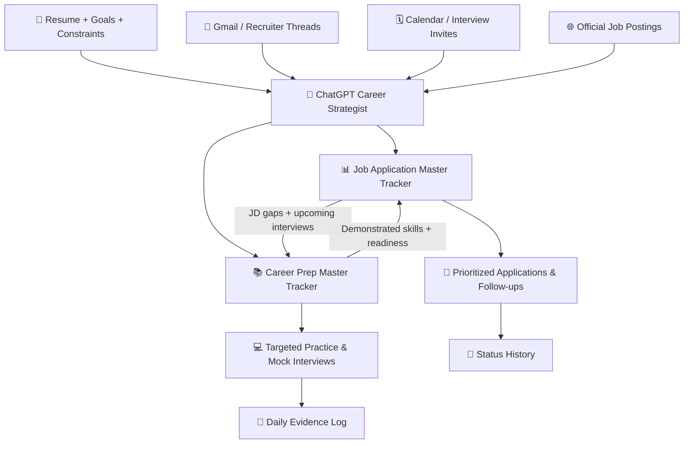

<div align="center">

# 🚀 CareerOS
### AI-Powered Job Search & Interview Preparation Tracker

**One career command center. Two persistent trackers. Evidence-backed decisions.**


*A reusable ChatGPT + Google Sheets + Gmail + Calendar workflow for career planning, job discovery, application tracking, and interview readiness.*

[⚡ Quick Start](#-quick-start) · [🧠 How It Works](#-how-it-works) · [📋 Trackers](#-the-two-trackers) · [🪄 Prompt Library](#-complete-prompt-library) · [🔁 Commands](#-daily-commands) · [🔐 Privacy](#-privacy--safety)

</div>

> [!IMPORTANT]
> **10–15 minutes** is the target for creating the structure and configuring the workflows, *not* for processing years of emails or completing a thorough assessment. Allow **1–2 hours** for the guided self-evaluation. A comprehensive first scan can take longer.

## ✨ What is CareerOS?

CareerOS is a **prompt-driven career-management system** designed for people who want more than a list of job postings.

| 🔎 Find the right jobs | 📬 Stay on top of applications | 🧠 Get interview-ready | 📊 Keep the evidence |
|---|---|---|---|
| Search by responsibilities and transferable skills, not title alone | Reconcile recruiter threads, interview invites, deadlines and rejections | Identify real skill gaps, practice deliberately, defend your resume | Maintain durable Google Sheets and append-only histories |
| Verify direct job links and distinct requisitions | Separate confirmed statuses from assumptions | Distinguish knowledge from independently demonstrated performance | Keep application and preparation data connected |

### Built from real iteration

This is a **generalized reconstruction** of a workflow refined between **late July and October 2026**. It captures the architecture, prompts, scoring, tracking and safeguards that emerged over time. The prompts are consolidated starter templates, **not verbatim historical transcripts**.

---

## ⚡ Quick Start

### Prerequisites

- A ChatGPT account with the relevant features available.
- Your current resume (PDF or DOCX).
- A Google account for **Drive / Sheets** (recommended).
- Optional connections to **Gmail** and **Google Calendar**.
- Optionally, 2–5 example job descriptions and a list of jobs already applied for.

> [!NOTE]
> Connected app availability and permissions vary by account, plan, organization and region. The workflow works manually without Gmail/Calendar access, but automatic reconciliation requires the relevant connection and permission.

### ⏱️ The 15-minute launch plan

| Time | Action | Result |
|:---:|---|---|
| **0–2 min** | Gather resume, target roles, location, compensation expectations and constraints | Candidate inputs ready |
| **2–5 min** | Open ChatGPT **Settings → Plugins** or the plugin directory; connect Drive, Gmail and Calendar where available | Authorized sources connected |
| **5–7 min** | Create two conversations: **Job Tracker** and **Career Prep Tracker** | Separate ownership |
| **7–10 min** | Upload your resume; use [Prompt 1](#prompt-1--bootstrap-profile-and-architecture-paste-into-job-tracker-chat), then create/adopt your sheets | Initial trackers |
| **10–12 min** | Apply [job rules](#prompt-4--permanent-job-tracker-rules-paste-into-job-tracker-chat) and [prep rules](#prompt-5--permanent-prep-tracker-rules-paste-into-prep-tracker-chat) | Persistent operating rules |
| **12–15 min** | Test one manual Gmail scan or application update; begin self-evaluation when ready | Verified baseline |

**Fastest path:** Upload a resume, then paste the [one-prompt bootstrap](#k-if-the-user-wants-the-absolute-simplest-setup) into ChatGPT.

<details>
<summary><strong>📁 Suggested GitHub repository layout</strong></summary>

```text
career-os/
├── README.md
├── templates/
│   ├── Job_Application_Master_Template.xlsx
│   └── Career_Prep_Master_Template.xlsx
└── prompts/
    └── Copy_Paste_Prompts_Only.md
```

Copy the two `.xlsx` files from the [starter pack](./Career_Tracker_Starter_Pack.zip) into `templates/`, and the prompts Markdown into `prompts/`. If you use a different folder layout, adjust these relative links.

</details>

---

## 🧠 How It Works



**The central principle:** job requirements inform the preparation plan; actual demonstrated preparation changes interview readiness. **Google Sheets stores the record** so each new conversation or run does not have to recreate the past.

---

## 📋 The Two Trackers

<table>
<tr>
<th>💼 Job Application Master Tracker</th>
<th>🎓 Career Prep Master Tracker</th>
</tr>
<tr>
<td>

**Six tabs**

1. `Dashboard`
2. `Applications Master`
3. `Active Pipeline`
4. `Watchlist`
5. `Status History`
6. `How to Update`

**Answers:** *Where should I apply? Who replied? What is due? What changed?*

</td>
<td>

**Five tabs**

1. `Dashboard`
2. `Static Syllabus`
3. `Daily Log`
4. `Execution Schedule`
5. `How to Update`

**Answers:** *What am I missing? What have I actually mastered? What should I study next?*

</td>
</tr>
</table>

### 📥 Spreadsheet templates

| File | Contents |
|---|---|
| [`Job_Application_Master_Template.xlsx`](./templates/Job_Application_Master_Template.xlsx) | Six-tab job pipeline, scoring, watchlist and status history |
| [`Career_Prep_Master_Template.xlsx`](./templates/Career_Prep_Master_Template.xlsx) | Five-tab prep dashboard, syllabus, study log and schedule |
| [`Copy_Paste_Prompts_Only.md`](./prompts/Copy_Paste_Prompts_Only.md) | All 18 reusable prompts |

**Import:** Upload each `.xlsx` to your own Google Drive → open with Google Sheets → use that newly created Sheet URL in ChatGPT. Do not point a public starter repo at anyone's private Google Sheet.

---

## 🪄 Complete Prompt Library

The handbook below contains **all 18 copy-paste prompts**, organized by setup, assessment, daily operations and automations.

| Stage | Prompts | What they do |
|---|---|---|
| 🏗️ Setup | **1–5** | Candidate profile, both Sheets and permanent operating rules |
| 🧪 Assessment | **6** | Guided 1–2-hour evaluation |
| 🔁 Daily operations | **7–16** | Gmail scan, reruns, status updates, interview prep, code review, offer decisions and audits |
| ⏰ Optional automation | **17–18** | Schedule verified recurring workflows |

> [!TIP]
> You do **not** need to paste all 18 prompts at once. Use Prompts 1–5 for setup, Prompt 6 for evaluation, and the remaining prompts when their workflows become relevant.

---

## C. Copy-and-paste prompts — setup

### PROMPT 1 — Bootstrap Profile and Architecture (paste into Job Tracker chat)

```text
You are my evidence-based Career Strategist and Job Application Tracker.

I will upload my resume and may supply LinkedIn data, job descriptions, application history and career constraints. First read what I provide. Build a factual candidate profile, distinguish verified facts from assumptions, and ask only the essential missing questions needed to proceed.

Capture: current and previous roles, actual responsibilities, years of experience, technical/professional strengths, tools, measurable impact, leadership/mentoring, industries, education/credentials, target titles and adjacent roles, location/work authorization, remote/hybrid/onsite preferences, travel/relocation preferences, compensation floor/target, timeline, current offers, and schedule constraints.

Create TWO logically separate systems:
A. Job Application Master Tracker: job discovery, applications, Gmail/Calendar reconciliation, official-link verification, scoring, status history, action priority.
B. Career Prep Master Tracker: self-evaluation, fixed syllabus, evidence-based learning log, interview prep, progress and mock interviews.

Do not invent resume accomplishments, job status, compensation, qualifications, or skill mastery. Do not confuse a preferred qualification with a hard blocker. Do not filter out fast-paced/high-stakes jobs merely on lifestyle assumptions. Ask whether I prefer two chats and two Sheets (recommended). Summarize my profile and propose the two-sheet architecture before making persistent changes.

Use my own Google Drive if connected. Never create duplicate trackers if one already exists. Ask before sending emails or making calendar changes.
```

### PROMPT 2 — Create the Job Application Google Sheet (paste into Job Tracker chat)

```text
Create or adopt ONE Google Sheet named "Job Application Master Tracker" in my own Google Drive. If I provide an existing Sheet URL, use that exact file and preserve its data, history, formatting and tabs. Do not silently replace it.

Create these tabs:
1. Dashboard — KPIs, action queue, interviews, application funnel, priority opportunities and freshness.
2. Applications Master — one authoritative row per actual application/requisition.
3. Active Pipeline — only interviews, assessments, follow-ups, offers, and urgent actions.
4. Watchlist — promising roles not yet verified as applied.
5. Status History — append-only dated material changes with source evidence.
6. How to Update — status vocabulary, scoring, deduplication, source hierarchy, and update rules.

Applications Master columns:
App ID | Company | Role | Location | Arrangement | Track | Channel | Req / Job ID | Applied Date | Posting Status | Application Status | Current Stage | Latest Status Date | Interview Date / Time | Contact / Recruiter | Compensation | Resume Fit /10 | Interview Readiness /10 | Low-Hanging /10 | Priority | Next Action | Action Due | Key Fit | Key Gaps | Source / Evidence | Job URL | Gmail Verified Date | Notes.

Active Pipeline columns:
Priority | App ID | Company | Role | Application Status | Current Stage | Interview / Due | Contact | Compensation | Resume Fit | Readiness | Next Action | Prep Focus | Latest Status | Days Since Update | Risk / Blocker | Outcome | Notes.

Watchlist columns:
Watch ID | Company | Role | Location | Arrangement | Posting Status | Resume Fit /10 | Readiness /10 | Realistic Conversion /10 | Priority | Why It Matters | Key Gaps | Next Action | Source Confidence | Last Verified | Notes.

Status History columns:
Date | App ID | Company | Role | Event | Old Status | New Status | Source | Action / Outcome | Notes.

Format with frozen headers, filters, date formats, clear column widths and status dropdowns. Use formulas for dashboard counts. Leave uncertain values blank or marked Unverified. Populate only from evidence. Report the created/adopted spreadsheet URL, tab names, and one sample update. If Drive write access is unavailable, tell me and give me an importable workbook/template instead.
```

### PROMPT 3 — Create the Career Prep Google Sheet (paste into Prep Tracker chat)

```text
Create or adopt ONE Google Sheet named "Career Prep Master Tracker" in my own Google Drive. If I provide an existing Sheet URL, update that exact file; never reset or replace it.

Create these tabs:
1. Dashboard — goals, target role(s), weighted readiness by skill track, next milestone, current interview priority.
2. Static Syllabus — durable milestones that do not get erased when a new job description arrives.
3. Daily Log — append-only evidence of actual practice and outcomes.
4. Execution Schedule — study windows and company-specific overlays, respecting my calendar and personal constraints.
5. How to Update — evidence standards, status vocabulary and progress rules.

Static Syllabus columns:
Track | Seq | Milestone / Topic | Target Depth | Status | Progress % | Evidence / Completion Criteria | Target Phase | Last Updated | Notes.

Daily Log columns:
Date | Track | Hours (only if confirmed) | What I Did | Evidence / Problems / Project | Milestone Updated | Progress Before % | Progress After % | Interview / Reason | Next Step.

Use a weighted skills dashboard whose weights add to 100. Let me approve the weights after self-evaluation. Do not infer that reading an explanation means mastery. Distinguish: Not Started, Exposed, Conceptually Understood, Implemented With Help, Implemented Independently, Interview Ready.

Preserve past achievements and practice history. Never fabricate study hours or raise progress without demonstrated evidence. Report the Sheet URL and the first recommended next action.
```

### PROMPT 4 — Permanent Job Tracker Rules (paste into Job Tracker chat)

```text
Use this conversation as the primary job-tracking thread and my existing Job Application Master Tracker Sheet as the persistent source of truth.

Operating rules:
1. Gmail-first: for any status update, search relevant connected accounts across All Mail, Inbox, Sent and job labels, excluding spam/trash; inspect plausible message bodies and full threads, not just subjects. Check whether I already replied. Use an overlap window of at least 48 hours for incremental scans.
2. Evidence hierarchy: actual recruiter/employer email or ATS status > verified official employer/ATS posting > fresh reputable secondary listing > unverified search snippet. State uncertainty.
3. One application row per distinct requisition. Never classify a Watchlist role as Applied without evidence. Do not resurface exact applied/rejected requisitions as new. Keep distinct requisitions separate even at the same company or client.
4. Preserve every rejection, closure, offer, interview and material status change in Status History; never erase historical rows.
5. For promising jobs, check the live official job opening and direct application endpoint. Capture direct URL, job/req ID, verification date, location, work arrangement, compensation when published, travel, deadline and link status. Do not invent or use a search-results URL as an application link.
6. Discover responsibility-first, not title-only. Search realistic adjacent roles and transferable domains. Separate hard blockers, trainable gaps and evidence/proof gaps.
7. Score separately: Resume Fit /10, Interview Readiness /10, Realistic Conversion /10, Career Growth, Compensation, Preparation Cost, and risk/blockers. Do not inflate readiness just because the resume matches keywords.
8. Do not assume fast-paced/high-stakes jobs, travel or unusual titles are undesirable. Follow my explicit preferences. Travel can add useful technical, customer or business exposure.
9. Prioritize confirmed interviews, assessment deadlines, unanswered recruiter requests and time-sensitive follow-ups over sending more applications.
10. Update Applications Master, Active Pipeline, Watchlist, Status History and Dashboard consistently; preserve sheet schema and historical data.
11. Distinguish NEW, APPLIED—WAITING, INTERVIEW/SCHEDULING, ACTION REQUIRED, POST-INTERVIEW WAITING, OFFER, REJECTED/CLOSED and UNVERIFIED.
12. Every meaningful recommendation must include its direct job link when available. Never claim a scan was completed if an account/tool was inaccessible.
13. Do not send emails, submit applications, or change calendar events without my explicit instruction and applicable permissions.

At the end of each update provide: what changed, why it matters, what I should do today, what remains uncertain, and the source/verification date.
```

### PROMPT 5 — Permanent Prep Tracker Rules (paste into Prep Tracker chat)

```text
This conversation is my primary preparation and self-evaluation thread. My Career Prep Master Tracker Google Sheet is the authoritative preparation record. Job-tracking chats and emails are secondary context for interview dates and skill requirements, not proof that I studied.

Maintain a durable syllabus. New job descriptions can temporarily reprioritize tracks but should not erase milestones or restart completed topics. Track actual evidence: independent coding solutions, timed attempts, runnable projects, tests, SQL queries, design explanations, mock-interview performance, and interview debriefs.

Distinguish exposure, conceptual understanding, implementation with help, independent implementation, and interview-ready mastery. Do not fabricate study hours, completed problems or confidence scores. Maintain a mistake log and revisit demonstrated weaknesses. Update Daily Log append-only and adjust milestone progress only when justified.

Teaching protocol: theory first, then a worked example, then conceptual questions, then one coding/problem-solving exercise at a time. Let me reason and write code before revealing a full solution. Review code like an interviewer, distinguish misread constraints from algorithmic gaps and Java/Python syntax gaps, and give precise corrections without premature full solutions. Do not rush from Easy to Medium when fundamentals are shaky.

Interview overlays: extract actual language requirements and interview formats from recruiter emails and JDs; never assume a language is mandatory unless supported. Build a company-specific plan without sacrificing the core syllabus. Use the Calendar to protect realistic study windows.

End each substantive session with: What we covered, Evidence of mastery, Open mistakes, Next exercise, and a concise "RESUME FROM HERE" marker identifying the exact next topic/problem. Keep the learning record consistent with the Sheet.
```

---

## D. The 1–2 Hour Self-Evaluation

**Purpose:** Separate professional experience, familiarity, practical implementation, and live-interview fluency. Self-rating alone is not enough. Use **Prompt 6** in the Prep chat, then answer the sections below. Allocate 10–15 minutes for profile/targets, 20–30 minutes for experience and project defense, 35–50 minutes for skills and independent questions, 15–20 minutes for scenarios, and 10 minutes for scheduling/prioritization.

### PROMPT 6 — Guided Self-Evaluation Interview

```text
Conduct a rigorous 1–2 hour career and interview-readiness evaluation. Do not dump all questions at once. Ask one focused group at a time, adapt follow-ups to my actual answers, and distinguish verified experience from assumptions.

Phase 1 — Career direction and constraints: target roles and levels, compensation, geography, relocation/travel, timeline, work authorization, family/schedule constraints, existing offers, risk appetite and why I want to move.
Phase 2 — Resume defense: for each major role/project ask what the system did, architecture, my exact contributions, design decisions, implementation details, tests, metrics, failure modes, ownership, mentoring and what I cannot honestly claim.
Phase 3 — Skills matrix: for each role-relevant topic assess conceptual knowledge, independent implementation, production experience, debugging, and interview fluency. Ask targeted technical questions and practical exercises, not only self-ratings.
Phase 4 — Job-description gap mapping: compare 2–5 target JDs to my actual evidence; identify hard blockers, trainable gaps, proof gaps and likely interview topics.
Phase 5 — Behavioral and seniority: ownership, conflict, ambiguity, trade-offs, failure, prioritization, mentorship, stakeholder communication and measurable outcomes. Use STAR-style probing but do not invent details.
Phase 6 — Practical constraints: actual weekly study windows, energy, existing interviews, preparation language(s), coding baseline, and available projects/tools.

Score each skill 0–5 using evidence:
0 = no exposure; 1 = recognize terminology; 2 = can explain with help; 3 = independently explain and complete a basic task; 4 = independently implement/debug representative tasks; 5 = consistently perform under interview conditions and defend trade-offs.

For every score, cite the evidence or mark Self-Reported / Unverified. Produce: (a) verified profile, (b) skill matrix, (c) target-role fit/readiness matrix, (d) ranked gaps, (e) fixed syllabus and milestone criteria, (f) realistic 2-week/30-day/90-day plan, (g) interview story bank, (h) top five next actions. Ask before saving any speculative score to the tracker.

Start with Phase 1, question 1.
```

#### Self-evaluation question bank (for the candidate)

**1. Career direction (10–15 min)**
- What exact roles and seniority are you targeting? What would make a new role better than your current role or offer?
- What compensation is required, desirable and negotiable? How do remote work, travel, location and growth change that?
- What is your deadline? What time can you realistically dedicate each week?

**2. Resume and project defense (20–30 min)**
- Pick your three strongest projects. For each: problem, customers, architecture, data flow, stack, your decisions, exact code/services/tests you built, hardest defect, observability, reliability, metrics and trade-offs.
- What did you personally own vs. what the team owned? What did you mentor? Which claims would you struggle to prove in a deep interview?
- What are your two most difficult failure stories and what did you learn?

**3. Technical/professional skills (35–50 min)**
- For each critical topic, provide: last time used, production depth, one independent example, confidence /5, and the next proof exercise.
- SDET/engineering sample tracks: Java or primary language, DS&A, SQL, API/backend, automation frameworks, CI/CD, distributed systems/messaging, cloud, Linux/networking, system design, observability, performance, domain-specific tools.
- Nontechnical roles: replace these with functional expertise, regulations, systems, analytics, program ownership, leadership, stakeholder management and decision authority.
- Demonstrate at least one independent coding/problem-solving task, one design/debug scenario and one experience-defense answer.

**4. JD mapping (15 min)**
- Which must-haves have direct proof? Which are preferred or trainable? Which are true blockers? Which responsibilities transfer from a different domain?
- Does the actual recruiter email narrow language, interview structure or technology requirements compared with the public JD?

**5. Interview and schedule (10–15 min)**
- What interviews are confirmed, pending or merely proposed? What are the actual dates, time zones and preparation languages?
- What is the shortest realistic daily study commitment? Which days are off-limits?
- Which two weaknesses would most improve interview conversion if fixed this week?

#### Evidence scoring and weighted progress

Keep **resume fit** separate from **interview readiness**. Example: a candidate may have 9/10 fit but 5/10 readiness because they are rusty at timed coding. Track confidence and evidence separately.

A historical SDET syllabus in this workflow used weights totaling 100: Java 18, DS&A 18, SQL/DB 14, Backend/API 14, Distributed Systems 12, Linux/OS/Networking 8, System Design 8, TypeScript/Playwright 5, Data Engineering 3. **These are an example from one candidate, not universal weights.** Recalculate weights from each person's target roles and current interviews.

---

## E. Copy-and-paste prompts — daily operation

### PROMPT 7 — `RERUN GMAIL` (manual status-only scan)

```text
RERUN GMAIL. Reconcile my connected job-related Gmail accounts with the existing Job Application Master Tracker. Search All Mail, Inbox, Sent and relevant job labels, not just unread mail. Cover the period since the last verified run with at least a 48-hour overlap; on the first run, use an agreed historical lookback (e.g., 90 days).

Read plausible message bodies and threads. Identify application confirmations, rejections, assessments, interviews, recruiter requests, offers, reschedules, deadlines and unanswered messages. Check whether I already responded and whether a Calendar invitation is confirmed. Reconcile company + requisition against the tracker. Update Applications Master, Active Pipeline and Status History only on evidence. Preserve rejected and closed records. Do not perform broad new-job discovery.

Report: urgent actions, interviews and deadlines, material status changes, pending recruiter replies, unresolved uncertainties, and exact tracker changes. If access is unavailable, say what was not checked; never claim a successful scan without evidence.
```

### PROMPT 8 — `RERUN` (incremental jobs + applications)

```text
RERUN. In the Job Tracker chat, perform a fresh Gmail-first delta reconciliation, Calendar check and current-tracker review. Then search for genuinely new high-fit job openings since the last run, verify direct official links, suppress exact applied/rejected/duplicate requisitions, and update the existing Google Sheet.

Use responsibility-first matching and my approved locations, salary, travel and career constraints. Score fit, readiness, realistic conversion, growth and preparation cost separately. Report material changes, strongest new roles, next actions, interview prep implications and uncertain links. Keep unchanged rows concise.
```

### PROMPT 9 — `FULL DEEP RERUN` (comprehensive rebuild of the market picture)

```text
FULL DEEP RERUN. Execute the comprehensive workflow in this exact order:

1. Gmail first: fresh broad scan across connected accounts, All Mail/Inbox/Sent/job labels, plausible bodies/threads, 48-hour overlap, response-state reconciliation and deadlines.
2. Calendar: verify interview invitations, confirmed vs proposed times, time zones, conflicts and preparation windows.
3. Tracker: reconcile every active interview, assessment, application, rejection, offer and recruiter thread before declaring anything NEW.
4. Posting recheck: verify tracked roles are open, closed, expired, removed or unverified; preserve historical rows.
5. Candidate discovery: search broadly by responsibilities and adjacent titles, aiming for ~30–50 plausible candidates when available; do not claim 30–50 were found if fewer exist. Include all approved geographies and work arrangements.
6. Official verification: confirm promising roles on employer/ATS pages, direct application URLs, requisition IDs, date checked, work model, compensation when published, deadline and travel.
7. Deduplicate exact requisitions and mirrored listings; preserve distinct requisitions and legitimate separate clients/teams.
8. Assess each strong role independently for resume fit /10, interview readiness /10, realistic conversion /10, career growth, compensation, preparation time, trainable gaps, proof gaps and hard blockers. Use current evidence and offer comparison where relevant.
9. Update the existing Job Application Master Tracker tabs without resetting or overwriting history.
10. Deliver a prioritized report in this order: INTERVIEWS/ACTION REQUIRED; GMAIL/COMPANY UPDATES; TRULY NEW HIGH-VALUE ROLES; REALISTIC LOW-HANGING ROLES; HIGH-GROWTH/HIGH-COMP ROLES; APPLIED—WAITING; CLOSING SOON; REJECTED/CLOSED; VERIFICATION UNCERTAINTIES; PREP IMPLICATIONS; WHAT I SHOULD DO TODAY.

Every new recommended job needs its direct link when available. Do not silently substitute generic alerts, outdated postings or invented availability for a deep rerun. Tell me if any source could not be accessed.
```

### PROMPT 10 — Mark an application or status change

```text
Update my Job Application Master Tracker with this evidence:
Company: [COMPANY]
Role: [ROLE]
Job URL / Req ID: [LINK OR ID]
Event: [APPLIED / REJECTED / INTERVIEW / OFFER / ASSESSMENT / WITHDRAWN / OTHER]
Date: [DATE]
Evidence: [EMAIL / SCREENSHOT / USER CONFIRMATION]
Notes / Next Action: [DETAILS]

Check for an existing exact requisition first. Update the correct application row, append Status History, update Active Pipeline if action is required, refresh dashboard counts, and confirm what changed. Do not create a duplicate or erase earlier statuses.
```

### PROMPT 11 — Interview-specific preparation

```text
Prepare me for [COMPANY] — [ROLE] — [INTERVIEW DATE/TIME]. Read the actual JD, recruiter emails and interview format first. Separate verified language requirements from assumptions. Compare responsibilities against my resume, project stories, and demonstrated readiness in the Career Prep Master Tracker.

Produce: expected round format, top technical/behavioral themes, must-know topics, likely coding language(s), high-risk gaps, resume claims likely to be challenged, and a realistic study schedule that respects existing commitments. Do not replace the fixed syllabus; temporarily overlay interview-critical work. Use theory -> examples -> independent exercises -> mock interview. Update readiness only from actual performance.
```

### PROMPT 12 — Resume defense and STAR bank

```text
Interrogate my resume as a skeptical senior interviewer. Take one project at a time. Ask me to explain architecture, data flow, APIs, ownership, implementation details, tests, failure handling, observability, security, trade-offs, collaboration and measured impact. Distinguish my work from the team's work. Challenge unsupported numbers and vague claims. Never invent details or coach me to claim production experience I don't have.

Build a defensible project/behavioral story bank with: question, concise answer, deep follow-ups, supporting evidence, gaps, and a 2-minute and 5-minute version. Do not move to the next project until I can defend the current one.
```

### PROMPT 13 — Guided study session

```text
Continue my Career Prep Master Tracker from RESUME FROM HERE. Use the syllabus and Daily Log to identify the next unfinished concept. Teach theory first, show a worked example, then ask conceptual questions, then give ONE coding/design problem. Do not reveal the full solution before my attempt. Review correctness, syntax, complexity, edge cases and explanation. Track mistakes separately from unfamiliarity with the concept. Afterward update the Sheet only with demonstrated evidence and state the exact next step.
```

### PROMPT 14 — End-of-day prep update

```text
Update my existing Career Prep Master Tracker for today's actual work. Read this conversation's substantive practice, code, exercises, mock interviews and implementation evidence. Append to Daily Log; update only justified Static Syllabus milestones and dashboard scores. Distinguish exposure, conceptual understanding, implementation with help, independent implementation and interview-ready fluency. Never invent hours. Do not mark a topic mastered because I read an explanation. Summarize progress, open mistakes, tomorrow's priorities and RESUME FROM HERE.
```

### PROMPT 15 — Offer comparison and decision

```text
Compare my current offer(s) against active interview opportunities and career goals. Use verified compensation, location, work arrangement, benefits, technical ownership, growth, risk, start date, commute/travel, family constraints and realistic probability of securing alternatives. Separate known terms from assumptions. Explain opportunity cost and what I gain/lose by waiting, negotiating or accepting. Do not assume a higher title is automatically better. Recommend next actions and any recruiter communication to draft; do not send anything without permission.
```

### PROMPT 16 — Monthly audit / reset without losing history

```text
Audit both existing trackers and the last 30 days of evidence. Reconcile stale applications, overdue follow-ups, unverified postings, duplicate requisitions, old interview dates, broken links, and stale dashboard calculations. Review whether readiness scores are supported by independent performance. Compare the job market's repeated requirements with the fixed syllabus. Recommend only evidence-based changes to target roles, scoring weights, preparation priorities and automation schedules. Preserve all history, IDs, schemas and user preferences. Show an explicit change log and ask before any structural migration.
```

---

## F. Status, scoring, and decision rules

### Status vocabulary

Use a controlled vocabulary, rather than inventing a new status for every email:

- Applied — Waiting
- Application Viewed (only if explicitly confirmed)
- Recruiter Screen Scheduled
- Interview Scheduling Pending
- Interview Scheduled
- Interview Completed — Waiting
- Assessment Pending
- Assessment Completed
- Action Required / Unverified
- Offer
- Rejected
- Withdrawn
- Closed

Do not infer that a job posting disappearing means the candidate was rejected. Do not treat an application confirmation as an interview invitation. A proposed time is not a confirmed interview.

### Separate scores — do not collapse them into one magic number

| Dimension | Question it answers | Evidence to use |
|---|---|---|
| Resume Fit /10 | Does the candidate's real background match the job's work? | Resume, accomplishments, responsibilities, must-haves |
| Interview Readiness /10 | Could the candidate pass this specific interview today? | Timed coding, mocks, JD language, framework depth |
| Realistic Conversion /10 | How plausible is recruiter/interview conversion? | Level, location, market, requirements, candidate positioning |
| Career Growth | Would this move develop the candidate's career? | Ownership, domain, scope, mentorship, trajectory |
| Compensation | Does total reward meet the candidate's goals? | Posted/recruiter-confirmed base, bonus, equity, benefits |
| Preparation Cost | What must be learned before interviewing? | Trainable gaps, time available, interview format |
| Hard Blockers | Is something truly non-negotiable? | Work authorization, required license, location, mandatory language |

**Low-hanging does not mean low-paying or junior.** It means a role where the candidate's evidence, current readiness and realistic chance of success align strongly.

### Deduplication keys

Prefer `Company + official requisition ID + location/team` when the same requisition may have legitimate geographic variants. Record source and date. If no requisition exists, use company + normalized title + location + official URL, and mark uncertain. Keep distinct team requisitions separate. An agency and direct employer may represent the same role; investigate before making a duplicate entry. Recruiter right-to-represent/submission conflicts must be verified, not guessed.

### History discipline

Every material event creates a dated Status History entry. The Applications Master row stores the latest state; history explains how it got there. Rejections and closures remain for conversion statistics and to prevent duplicate recommendations. A new status must have a source: employer email, ATS screenshot, Calendar invitation, or user-confirmed action.

---

## G. Automations (optional, only after manual runs work)

The historical system evolved toward a **daily 8:00 AM job rerun** and a separate **11:50 PM preparation update** in the candidate's time zone. These are examples, not universal times. In the original workflow, duplicate tasks were disabled when consolidated. Importantly, the preparation automation was later disabled; a setup guide must not assume a task is running just because it was once created.

### PROMPT 17 — Schedule the job rerun

```text
Create ONE recurring automation named "My High-Fit Job Tracker" at [TIME] every day in [IANA TIME ZONE]. Each run should execute the FULL DEEP RERUN prompt in my Job Tracker conversation, update only my existing Job Application Master Tracker Sheet [URL], and deliver its report to the appropriate tracker conversation. Do not create a new Sheet or a duplicate automation. Check for existing tasks before adding one, and verify the new task is enabled. If the platform cannot guarantee delivery to the original chat, tell me rather than promising it.
```

### PROMPT 18 — Schedule the prep update

```text
Create ONE recurring automation named "My Career Prep Update" at [TIME] every day in [IANA TIME ZONE]. Review actual preparation completed since the last run, update only my existing Career Prep Master Tracker Sheet [URL], preserve append-only history, never fabricate study hours or mastery, and provide a concise progress report with RESUME FROM HERE. Do not duplicate the job-search rerun. Verify that the automation is enabled and that its output destination works; report any limitation honestly.
```

**Automation checklist:** Task exists; correct time zone; enabled; correct conversation/destination; correct Google Sheet ID; connected-account access works during scheduled execution; last-run timestamp advances; report arrives; no duplicate notifications. If an automation repeatedly fails, use manual `RERUN`/`END-OF-DAY` prompts while investigating. Do not pretend it ran.

---

## H. Ten-minute smoke test

1. **Sheets:** Ask ChatGPT to list both workbook titles and exact tabs; verify the intended URLs, not lookalike copies.
2. **Write test:** Add one dummy Watchlist entry and one dummy Daily Log entry (clearly marked TEST); verify both appear in the right sheets, then remove them on request. Never overwrite historical data.
3. **Gmail test:** Ask for one recent non-sensitive job-related subject and whether you replied; verify it matches the actual thread. If Gmail isn't connected, expect an explicit limitation.
4. **Calendar test:** Ask for one known interview event; distinguish confirmed invitation from merely proposed availability.
5. **Link test:** Ask for one live official job opening, exact requisition and verification date. Reject a search-results URL.
6. **Score test:** Ask why resume fit and interview readiness differ for the same role; require supporting evidence.
7. **History test:** Mark a test application as rejected and verify the historical event remains after the status changes.
8. **Automation test:** If scheduled, run once and check enabled state, correct destination and timestamps. Avoid creating a second task to fix the first without checking existing tasks.

---

## I. What the historical build taught us

**Late July — baseline first.** The workflow began with a career transition and a frank readiness assessment. The user needed fundamentals, a practical schedule, project evidence and regular interview-style checks, not simply a list of learning resources.

**August — job discovery became cumulative.** A resume-based search evolved into tracking every application, including rejections, and searching beyond narrow job titles. A separate email-status monitor was merged into the job tracker so application history and incoming evidence stayed consistent.

**Early September — full reruns became disciplined.** `RERUN GMAIL` was distinguished from `RERUN`; later `FULL DEEP RERUN` added broad market discovery, official posting checks, requisition deduplication, realistic fit/readiness scores and action priorities. Missing rejections in email led to broader All Mail/body/thread scanning rather than relying on job labels.

**Mid-September — persistence and automation.** Two Google Sheets became authoritative: the job workbook with Dashboard, Applications Master, Active Pipeline, Watchlist, Status History and How to Update; and the prep workbook with Dashboard, Static Syllabus, Daily Log, an execution schedule and How to Update. Automations were refined to use those exact files and avoid duplicate reports.

**Late September–October — evidence and conversion over activity.** Preparation logs distinguished exposure from independent performance. Interview preparation used the actual recruiter email/JD, including programming language requirements, rather than guessing. Offers became a comparison baseline. The workflow learned to prioritize confirmed interviews and actions, avoid overfiltering ambitious roles, and preserve the candidate's personal constraints without inventing them.

### What not to copy blindly

- Do not copy another candidate's salaries, immigration situation, geography, interview schedule, scoring weights, or resume claims.
- Do not copy someone else's private spreadsheet URL or Gmail address into your own tracker.
- Do not assume any connected plugin can automatically read/write during scheduled tasks without testing.
- Do not interpret 'FULL DEEP RERUN' as proof that the model accessed Gmail, Calendar, and every employer website; demand a source-by-source completion report.
- Do not let a static dashboard become a source of stale facts; derive counts and dates from the underlying authoritative rows.
- Do not claim skill mastery from study time or explanations alone.
- Do not create a new sheet each day. Stable IDs and append-only history are the point.

---

## J. One-page quick-reference commands

| Command | Where | Meaning |
|---|---|---|
| `RERUN GMAIL` | Job chat | Gmail/Calendar/application status reconciliation only |
| `RERUN` | Job chat | Incremental reconciliation + genuinely new job discovery |
| `FULL DEEP RERUN` | Job chat | Broad 30–50-role candidate pool when available, verified links, dedupe, scoring, all tracker updates |
| `APPLIED: [company, req, date]` | Job chat | Add application, evidence and history |
| `INTERVIEW: [company, round, time]` | Both | Update pipeline and company-specific prep |
| `PREP SESSION` | Prep chat | Theory → example → question → independent practice |
| `REVIEW MY CODE` | Prep chat | Interviewer-style code review, no premature full solution |
| `RESUME FROM HERE` | Prep chat | Continue exactly from last substantive topic |
| `END-OF-DAY PREP UPDATE` | Prep chat | Evidence-based log and progress update |
| `MONTHLY AUDIT` | Both | Reconcile stale records and readiness without losing history |

---

## K. If the user wants the absolute simplest setup

Paste this one prompt into a new chat after uploading a resume:

```text
Build me a complete two-part career management system in my own Google Drive: (1) Job Application Master Tracker with Dashboard, Applications Master, Active Pipeline, Watchlist, Status History, and How to Update; (2) Career Prep Master Tracker with Dashboard, Static Syllabus, Daily Log, Execution Schedule, and How to Update. First analyze my resume, ask essential questions about goals, geography, compensation and constraints, and identify the relevant connected Gmail, Calendar and Drive accounts. Do not invent experience, applications, status or study progress. Use one row per distinct requisition, append-only history, direct verified official job links, separate fit/readiness/conversion scores, responsibility-first matching, Gmail-first status reconciliation, and an evidence-based syllabus. Give me the two Sheet links, the exact operating rules, a guided 1–2 hour self-evaluation, and the commands RERUN GMAIL, RERUN, FULL DEEP RERUN, PREP SESSION, and END-OF-DAY PREP UPDATE. Do not schedule recurring tasks until we have tested one manual run and I approve the schedule.
```

**Recommended starting point:** Use the 10–15 minute setup first, then complete the self-evaluation before trusting readiness scores. The value comes from the discipline of evidence, history, and prioritization—not from having a large spreadsheet.


---

## 🔁 Daily Commands

| Command | Chat | Use it for |
|---|---|---|
| `RERUN GMAIL` | Job Tracker | Reconcile applications and recruiter email without a broad new search |
| `RERUN` | Job Tracker | Incremental application reconciliation + new verified roles |
| `FULL DEEP RERUN` | Job Tracker | Broad search, source verification, deduplication, scoring and prioritized actions |
| `APPLIED: [company, req ID, date]` | Job Tracker | Record a newly submitted application |
| `INTERVIEW: [company, round, time]` | Both | Update pipeline and preparation priorities |
| `PREP SESSION` | Prep Tracker | Theory → examples → questions → independent practice |
| `REVIEW MY CODE` | Prep Tracker | Interviewer-style review without immediate full solutions |
| `END-OF-DAY PREP UPDATE` | Prep Tracker | Log evidence and update demonstrated readiness |
| `MONTHLY AUDIT` | Both | Reconcile stale statuses and adjust plans without deleting history |

---

## 🔐 Privacy & Safety

> [!CAUTION]
> Never commit private resume details, personal email exports, recruiter messages, compensation negotiations, passwords, API tokens, or private Google Sheet URLs to a **public GitHub repository**.

- Connect only the accounts and permissions needed for the task.
- Require explicit approval before sending email, submitting an application, or changing calendar events.
- Preserve rejections and completed applications as history rather than deleting them.
- Do not invent job availability, interview times, applicant status, salary, or study hours.
- Do not equate a scheduled automation with a **verified successful run**. Check what sources were actually accessed and what was updated.
- Avoid duplicate scheduled jobs and duplicate authoritative spreadsheets.
- Treat self-assessed skill ratings as provisional until backed by examples or independent practice.

## ❓ FAQ

<details>
<summary><strong>Can I use CareerOS without Google integrations?</strong></summary>

Yes. Paste your resume, provide application updates manually, and use the spreadsheet templates locally. Gmail/Calendar reconciliation and automatic Sheet writes require compatible connections and permissions.

</details>

<details>
<summary><strong>Will the system automatically apply to jobs or send recruiters emails?</strong></summary>

Not by default. The prompts explicitly separate recommendations and drafts from external actions. Sending messages, submitting applications and changing events should require your authorization and supported capabilities.

</details>

<details>
<summary><strong>Why keep two separate trackers?</strong></summary>

A job posting is evidence of market demand; a solved problem or a defended project is evidence of preparation. Separating the records prevents a long list of requirements from being mistaken for actual learning progress.

</details>

<details>
<summary><strong>Does a 90% resume match mean 90% interview readiness?</strong></summary>

No. Resume fit, current interview readiness, realistic conversion probability and career-growth value are separate judgments. Each needs its own evidence and uncertainty.

</details>

<details>
<summary><strong>Can this work for careers outside software engineering?</strong></summary>

Yes. Replace the technical syllabus with role-specific skills, certifications, case studies, portfolio work or practical interview tasks. The tracking architecture is profession-agnostic.

</details>

---

<div align="center">

### ⭐ CareerOS

**Less spreadsheet chaos. More evidence. Better career decisions.**

*Created as a reusable, generalized starter kit from an iterative career-tracking workflow developed July–October 2026.*

</div>
