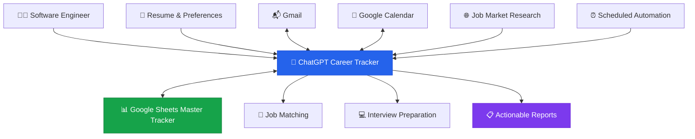
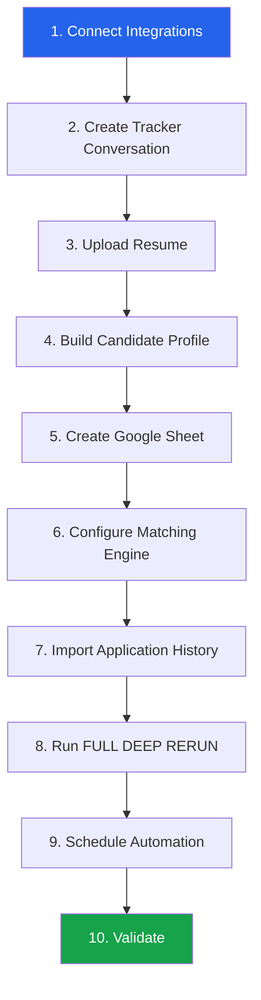
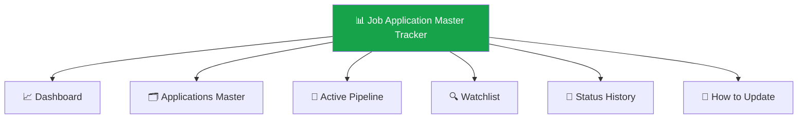
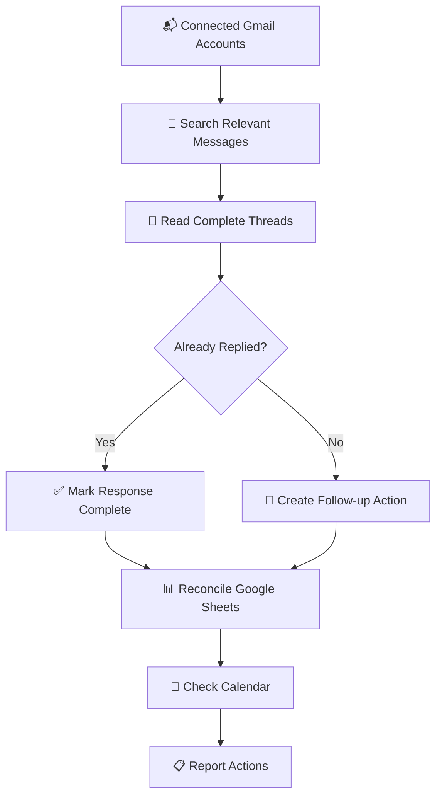

<div align="center">

# 🚀 High-Fit SDE Career Tracker

### An AI-Powered Job Search, Application Tracking & Interview Preparation System

**One conversation. One application tracker. One intelligent career workflow.**

A practical, reusable guide to building a personalized software engineering career tracker using **ChatGPT, Gmail, Google Calendar, Google Sheets, and AI automation**.

<br>


<br>

**[⚡ Quick Start](#quick-start) · [✨ Features](#features) · [🛠️ Setup Guide](#setup-guide) · [🧠 Matching Engine](#matching-engine) · [🔥 Full Deep Rerun](#full-deep-rerun) · [⏰ Automation](#automation) · [❓ FAQ](#faq)**

<br>

> **Spend less time managing your job search. Spend more time preparing for the opportunities that matter.**

</div>

---

<a id="overview"></a>

## 📖 Overview

Searching for a software engineering job is more than finding open positions.

A serious job search involves:

- Discovering relevant opportunities across multiple job boards.
- Understanding which positions actually match your engineering background.
- Comparing compensation, career growth, and technical ownership.
- Tracking dozens or hundreds of applications.
- Following recruiter conversations across email accounts.
- Managing interview invitations, assessments, and deadlines.
- Preparing for coding, system design, and behavioral interviews.
- Avoiding duplicate applications.
- Making informed decisions between competing opportunities.

Most people manage these activities using disconnected tools.

**This guide shows you how to connect them into one AI-assisted workflow.**

The result is a personalized career management system that understands your experience, maintains your application history, researches opportunities, and helps you decide what deserves your attention.

### 🎯 Who Is This For?

This guide is designed for:

- Software Development Engineers (SDE I / II / III)
- Software Engineers (SWE)
- Backend Engineers
- Full Stack Engineers
- Platform Engineers
- Cloud Engineers
- Infrastructure Engineers
- Distributed Systems Engineers
- Developer Productivity Engineers
- Engineers exploring adjacent technical roles

It is especially useful for experienced engineers managing multiple applications and interview processes simultaneously.

**You do not need to write code to use this guide.**

---

<a id="features"></a>

## ✨ Features

| Capability | What It Does |
|:---|:---|
| 🧠 **Candidate Intelligence** | Builds a reusable engineering profile from your resume and experience |
| 🔍 **Intelligent Job Discovery** | Finds opportunities beyond exact job-title matches |
| 📊 **Opportunity Scoring** | Evaluates technical fit, readiness, interview potential, and growth |
| 📬 **Gmail Reconciliation** | Tracks applications, recruiters, assessments, offers, and rejections |
| 📅 **Calendar Awareness** | Identifies interviews, conflicts, and preparation windows |
| 🗂️ **Persistent Google Sheets Tracker** | Maintains one cumulative application database |
| 🛡️ **Duplicate Protection** | Avoids recommending already-applied requisitions |
| 🔗 **Job Verification** | Checks official employer and ATS application pages |
| 💰 **Compensation Benchmarking** | Compares opportunities against your current situation |
| 🎯 **Interview Preparation** | Prioritizes coding, system design, and technical preparation |
| ⏰ **Scheduled Automation** | Supports recurring application and job-market updates |
| 📜 **Historical Tracking** | Preserves application status changes and evidence |

### What Makes It Different?

This is not simply a prompt that asks ChatGPT to find jobs.

It is a **repeatable operating methodology** that combines:

1. Personal career context.
2. Historical application records.
3. Email and calendar reconciliation.
4. Broad job-market discovery.
5. Technical and career-fit analysis.
6. Official job verification.
7. Persistent tracking.
8. Interview preparation.
9. Action-oriented reporting.

---

<a id="architecture"></a>

## 🏗️ System Architecture



### Technology Stack

| Component | Technology | Responsibility |
|---|---|---|
| Intelligence | ChatGPT | Reasoning, matching, prioritization |
| Communication | Gmail | Application and recruiter reconciliation |
| Scheduling | Google Calendar | Interview and availability management |
| Persistent Storage | Google Sheets | Application tracking and historical records |
| Market Research | Web search | Opportunity discovery and verification |
| Automation | ChatGPT Tasks | Scheduled execution and reporting |

> [!IMPORTANT]
> This is a **prompt-based workflow**, not a standalone software application.
>
> It depends on the tools and permissions available to your ChatGPT account. Connected integrations must be authorized by the user. Some operations, especially scheduled access to connected apps and spreadsheet editing, may vary by plan or environment.

---

<a id="quick-start"></a>

## ⚡ Quick Start

### ⏱️ How Long Does Setup Take?

| Activity | Estimated Hands-On Time |
|---|---:|
| Connect Google integrations | 2–3 minutes |
| Create the tracker conversation | 1 minute |
| Upload resume and enter preferences | 2–3 minutes |
| Initialize Google Sheets | 2–3 minutes |
| Configure matching and rerun methodology | 2–3 minutes |
| Request the first run and automation | 1–2 minutes |
| **Total Initial Configuration** | **~10–15 minutes** |

**Important:** These estimates describe your hands-on setup time, not the time needed for ChatGPT to complete every operation.

The first historical Gmail reconciliation, spreadsheet population, broad job-market search, and acceptance test may take additional time.

You can start using the tracker before every optional feature is configured.

### Prerequisites

- [ ] ChatGPT account with access to relevant tools
- [ ] Updated resume (PDF or DOCX)
- [ ] Google account
- [ ] Gmail integration, if email reconciliation is desired
- [ ] Google Calendar integration, if scheduling intelligence is desired
- [ ] Google Drive integration with spreadsheet access
- [ ] Basic information about your target jobs and compensation

### 🚀 The Setup Sequence



---

<a id="setup-guide"></a>

# 🛠️ Complete Setup Guide

Every step includes a ready-to-copy ChatGPT prompt.

**Follow the steps in order.**

You can use the same ChatGPT conversation throughout the setup.

---

<a id="step-1"></a>

## Step 1 — Connect Your Google Integrations

Open ChatGPT and navigate to **Settings → Plugins**, or access Plugins through the chat sidebar.

Look for:

| Integration | Why You Need It |
|---|---|
| **Gmail** | Reads application confirmations, recruiter correspondence, and interview updates |
| **Google Calendar** | Reads upcoming interviews, availability, and conflicts |
| **Google Drive** | Creates and updates the Google Sheets tracker |

Google Sheets functionality is provided through the Google Drive integration where supported.

### Recommended Configuration

Connect every Gmail account you actively use for job applications.

For example:

```text
Personal Gmail
Professional Gmail
Secondary Job-Search Gmail
```

The tracker should search all authorized accounts rather than assuming every application belongs to one inbox.

> [!NOTE]
> If you cannot connect Gmail or Calendar, you can still use the job discovery and application tracking portions of this system.
>
> Those capabilities should be marked as unavailable rather than pretending that reconciliation occurred.

### 📋 Prompt 1 — Verify Connections

<details>
<summary><strong>📋 Click to expand and copy Prompt 1</strong></summary>

```text
I am setting up my High-Fit SDE Career Tracker.

Verify which of the following integrations are connected
and operational:

1. Gmail
   - Identify authorized connected accounts.
   - Verify read access.

2. Google Calendar
   - Verify access to upcoming events.

3. Google Drive / Google Sheets
   - Verify spreadsheet creation capabilities.
   - Verify spreadsheet reading capabilities.
   - Verify spreadsheet editing capabilities.

Do not send emails, create events, or modify existing
files during this verification.

Report:

- Connected integrations
- Successfully tested capabilities
- Missing permissions
- Unsupported operations
- Required next steps

Do not claim an integration is operational unless
you actually verified its functionality.
```

</details>

**Expected result:** ChatGPT tells you which integrations are working and whether additional authorization is required.

---

<a id="step-2"></a>

## Step 2 — Create Your Career Tracker Conversation

Create a new ChatGPT conversation.

Suggested name:

**High-Fit SDE Career Tracker**

This conversation becomes your primary career-management workspace.

You can use separate conversations for coding practice or system design, but your application database should remain centralized.

### 📋 Prompt 2 — Initialize the Career Tracker

<details>
<summary><strong>📋 Click to expand and copy Prompt 2</strong></summary>

```text
You are my High-Fit SDE Career Search and
Application Tracking Assistant.

This is an ongoing career management system,
not a one-time job search.

YOUR RESPONSIBILITIES:

1. Understand my actual engineering experience.
2. Discover relevant software engineering opportunities.
3. Evaluate jobs based on responsibilities and technical fit.
4. Compare compensation, career growth, and flexibility.
5. Track applications and recruiter interactions.
6. Reconcile Gmail and Google Calendar.
7. Maintain one persistent Google Sheets tracker.
8. Avoid duplicate application recommendations.
9. Verify job openings on official sources.
10. Track interviews, assessments, and deadlines.
11. Recommend interview preparation priorities.
12. Preserve application history.
13. Produce actionable career reports.

OPERATING RULES:

- Treat my confirmed resume and experience as primary evidence.
- Do not invent technical skills or employment history.
- Use one persistent Google Sheets tracker.
- Do not create replacement trackers without permission.
- Reconcile existing records before declaring jobs NEW.
- Preserve rejected and closed application history.
- Distinguish verified facts from assumptions.
- Report integration or tool failures clearly.
- Prioritize actions that materially improve my job search.

Use this conversation as the primary reporting workspace.

Start by helping me build my canonical engineering profile.

Ask only the essential questions needed.
```

</details>

---

<a id="step-3"></a>

## Step 3 — Build Your Canonical Engineering Profile

Upload your latest resume.

A strong matching system must understand **what you actually built and owned**, not merely which technologies appear in your resume.

### Example: Why This Matters

Consider an engineer who has:

- Built Java backend services.
- Designed REST APIs.
- Worked with AWS Lambda.
- Implemented asynchronous workflows.
- Used SQS, SNS, or Kafka.
- Built CI/CD pipelines.
- Debugged production systems.
- Mentored other engineers.

A basic keyword search might only recommend Java Developer positions.

A responsibility-first matching engine may also identify:

- Backend Platform Engineer
- Distributed Systems Engineer
- Cloud Software Engineer
- API Infrastructure Engineer
- Developer Productivity Engineer
- Reliability-focused Software Engineer

### 📋 Prompt 3 — Build Candidate Profile

<details>
<summary><strong>📋 Click to expand and copy Prompt 3</strong></summary>

```text
Analyze my uploaded resume and build my canonical
Software Development Engineer candidate profile.

Do not simply summarize my resume.

EXTRACT:

1. Total professional engineering experience.
2. Programming languages and depth of proficiency.
3. Backend, frontend, and full-stack experience.
4. Cloud and infrastructure experience.
5. Distributed systems and messaging experience.
6. Databases and data modeling experience.
7. System design and architecture ownership.
8. Production debugging and reliability experience.
9. Projects or systems built from scratch.
10. CI/CD and developer tooling experience.
11. Technical leadership and mentorship.
12. Measurable engineering impact.
13. Strongest technical interview stories.
14. Transferable skills.
15. Trainable technical gaps.
16. Hard blockers requiring substantial retraining.

Ask targeted follow-up questions about missing information.

THEN BUILD:

A. Canonical Engineering Profile
B. Target Engineering Levels
C. Eligible Job Families
D. Strongest Resume Positioning
E. Core Technical Strengths
F. Realistic Technical Weaknesses
G. Career Growth Opportunities
H. Reusable Job-Matching Profile

Use only evidence from my resume and confirmed answers.

Do not inflate proficiency or invent experience.

Maintain this profile as new information becomes available.
```

</details>

### 📋 Prompt 3B — Configure Career Preferences

<details>
<summary><strong>📋 Click to expand and copy Prompt 3B</strong></summary>

```text
Add these preferences to my canonical career profile.

CURRENT LOCATION:
[YOUR CITY AND COUNTRY]

TARGET LOCATIONS:
[LOCAL / REMOTE / RELOCATION REGIONS]

WORK AUTHORIZATION:
[COUNTRIES WHERE YOU CAN LEGALLY WORK]

PREFERRED ARRANGEMENT:
[REMOTE / HYBRID / ONSITE / FLEXIBLE]

CURRENT COMPENSATION:
[AMOUNT + CURRENCY / OPTIONAL]

CURRENT OFFER BENCHMARK:
[AMOUNT + CURRENCY / IF APPLICABLE]

TARGET COMPENSATION:
[AMOUNT + CURRENCY]

TARGET ENGINEERING LEVEL:
[SDE II / SENIOR / STAFF / OTHER]

PREFERRED ENGINEERING DOMAINS:
[BACKEND / CLOUD / PLATFORM / FULL STACK / ETC.]

RELOCATION WILLINGNESS:
[YES / NO / CONDITIONAL]

TRAVEL WILLINGNESS:
[YES / NO / CONDITIONAL]

HARD CONSTRAINTS:
[LIST ANY NON-NEGOTIABLE REQUIREMENTS]

CAREER PRIORITIES:
[COMPENSATION / GROWTH / OWNERSHIP / FLEXIBILITY / ETC.]

INTERVIEW PREPARATION AVAILABILITY:
[HOURS PER WEEK / OPTIONAL]

Use these preferences for future searches and recommendations.

Do not assume demanding roles are undesirable.

Do not assume remote flexibility is always more important
than compensation.

Ask for clarification when an important preference is missing.
```

</details>

---

<a id="step-4"></a>

## Step 4 — Create Your Google Sheets Application Tracker

The system uses **one authoritative Google Sheets spreadsheet**.

This is important because ChatGPT conversations and automation runs should not become competing databases.

### Recommended Workbook Structure



| Sheet | Purpose |
|---|---|
| **Dashboard** | Overview of applications, interviews, offers, and action items |
| **Applications Master** | Permanent database of all submitted applications |
| **Active Pipeline** | Current interviews, assessments, and recruiter actions |
| **Watchlist** | Promising roles that have not yet been applied to |
| **Status History** | Historical record of important changes |
| **How to Update** | Field definitions, scoring rules, and maintenance methodology |

### 📋 Prompt 4 — Create the Tracker

<details>
<summary><strong>📋 Click to expand and copy Prompt 4</strong></summary>

```text
Create a native Google Sheets spreadsheet named:

High-Fit SDE Job Application Master Tracker

This spreadsheet must be my single persistent
career tracking database.

CREATE SIX TABS:

1. Dashboard
2. Applications Master
3. Active Pipeline
4. Watchlist
5. Status History
6. How to Update

APPLICATIONS MASTER COLUMNS:

App ID
Company
Role
Location
Work Arrangement
Engineering Track
Application Channel
Requisition ID
Applied Date
Posting Status
Application Status
Current Stage
Latest Status Date
Interview Date/Time
Recruiter/Contact
Compensation
Resume Fit /10
Interview Readiness /10
Low-Hanging /10
Career Growth /10
Priority
Next Action
Action Due
Key Fit
Key Gaps
Source/Evidence
Direct Job URL
Gmail Verified Date
Notes

WATCHLIST COLUMNS:

Watch ID
Company
Role
Requisition ID
Location
Arrangement
Compensation
Travel
Resume Fit
Readiness
Low-Hanging
Career Growth
Hard Blockers
Trainable Gaps
Posting Status
Verified Date
Direct Application URL
Priority
Notes

STATUS HISTORY COLUMNS:

Timestamp
Application/Watch ID
Company
Previous Status
New Status
Evidence Source
Action Taken
Next Action
Due Date

ACTIVE PIPELINE:

Create an action-focused view containing:
- Interviews
- Assessments
- Recruiter follow-ups
- Offers
- Upcoming deadlines

DASHBOARD:

Include:
- Total applications
- Active applications
- Interviews
- Assessments
- Offers
- Rejections
- Pending actions
- Upcoming deadlines

FORMATTING:

- Freeze headers.
- Enable filters.
- Wrap long text.
- Use readable column widths.
- Highlight urgent actions.
- Distinguish statuses visually.
- Preserve historical information.
- Use formulas or derived views where supported.

HOW TO UPDATE:

Document:
- Field definitions
- Status conventions
- Scoring methodology
- Deduplication rules
- Posting verification methodology
- Evidence standards

AFTER CREATION:

1. Return the actual spreadsheet URL.
2. Return the spreadsheet ID.
3. Verify all six tabs exist.
4. Treat this spreadsheet as authoritative.

Never create a replacement spreadsheet without my permission.

If creation or editing fails, report the failure clearly.

Do not claim a successful update without read-back verification.
```

</details>

### Existing Spreadsheet?

If you already have a spreadsheet, use this instead:

```text
I already have an application tracker.

Inspect the existing Google Sheet and adapt it to the
High-Fit SDE methodology.

Preserve existing applications, formulas, formatting,
tabs, and historical records.

Do not create a replacement spreadsheet.

Ask before making destructive structural changes.
```

---

<a id="matching-engine"></a>

# 🧠 The High-Fit Matching Engine

This is the intelligence layer of the system.

Instead of asking:

> Does the job description contain the same keywords as my resume?

The tracker asks:

> Can this engineer realistically perform the responsibilities of this role, succeed in its interview process, and benefit from the opportunity?

---

<a id="scoring"></a>

## 📊 Multi-Dimensional Opportunity Scoring

Each opportunity is evaluated across four separate dimensions.

| Dimension | Suggested Weight | Meaning |
|---|---:|---|
| **Resume Fit** | 35% | How well your actual experience matches the job |
| **Interview Readiness** | 25% | How prepared you are for the expected interviews |
| **Low-Hanging Potential** | 20% | How realistically you could reach the interview stage |
| **Career Growth** | 20% | Ownership, technical depth, leadership, and future upside |

### Suggested Formula

```text
Overall Score =
    (Resume Fit × 0.35)
  + (Interview Readiness × 0.25)
  + (Low-Hanging Potential × 0.20)
  + (Career Growth × 0.20)
```

### Example

| Dimension | Score |
|---|---:|
| Resume Fit | 9/10 |
| Interview Readiness | 7/10 |
| Low-Hanging Potential | 8/10 |
| Career Growth | 9/10 |
| **Overall Score** | **8.3/10** |

> [!NOTE]
> These scores are structured estimates, not statistically validated probabilities.
>
> Compensation, work authorization, location eligibility, and hard technical blockers remain separate decision factors.

### Hard Blockers vs. Trainable Gaps

| Requirement | Candidate Background | Assessment |
|---|---|---|
| Java backend development | Production Java services | Strong Match |
| REST API development | Designed and maintained APIs | Strong Match |
| AWS | Production AWS experience | Strong Match |
| Kafka | Experience with SQS/SNS | Transferable Skill |
| Go | Strong Java/Python foundation | Trainable Gap |
| Kubernetes | Docker and cloud experience | Partial Match |
| Linux kernel engineering | No low-level systems experience | Potential Hard Blocker |

The objective is to avoid both extremes:

- Rejecting good jobs because of one unfamiliar framework.
- Recommending unrealistic jobs requiring months of unrelated retraining.

### 📋 Prompt 5 — Configure the Matching Engine

<details>
<summary><strong>📋 Click to expand and copy Prompt 5</strong></summary>

```text
Configure my High-Fit SDE Matching Engine.

SEARCH RESPONSIBILITY-FIRST, NOT TITLE-ONLY.

ELIGIBLE JOB FAMILIES:

- Software Development Engineer
- Software Engineer
- Backend Engineer
- Full Stack Engineer
- Platform Engineer
- Distributed Systems Engineer
- Cloud Software Engineer
- Infrastructure Software Engineer
- API / Integration Engineer
- Developer Productivity Engineer
- Reliability-focused Software Engineer
- Adjacent engineering roles with transferable responsibilities

Do not exclude unusually titled jobs when their
actual responsibilities match my experience.

SCORING:

1. Resume Fit /10
2. Interview Readiness /10
3. Low-Hanging Potential /10
4. Career Growth /10
5. Compensation
6. Preparation Required

SUGGESTED WEIGHTS:

Resume Fit: 35%
Interview Readiness: 25%
Low-Hanging Potential: 20%
Career Growth: 20%

MATCHING PRINCIPLES:

- Weight hands-on engineering experience heavily.
- Recognize transferable skills.
- Separate hard blockers from trainable gaps.
- Consider system design and production ownership.
- Consider architecture and technical leadership.
- Consider mentorship and collaboration.
- Consider remote flexibility.
- Consider relocation and travel preferences.
- Do not automatically reject demanding roles.
- Compare opportunities against my current benchmark.

DEDUPLICATION:

Read Applications Master and Watchlist before
calling any opportunity NEW.

Use:
- Company
- Requisition ID
- Official job URL
- Title and location as supporting evidence

Different requisitions at the same employer remain distinct.

The same end client is not automatically a duplicate.

Preserve applied, rejected, closed, and expired history.

Never recommend an already-applied exact requisition as NEW.

VERIFICATION:

Prefer official employer and ATS postings.

Record:
- Direct application URL
- Requisition ID
- Verification date
- Posting status
- Location
- Work arrangement
- Remote eligibility
- Compensation and currency
- Travel requirements
- Application deadline when published

Never invent missing information.

Apply these rules to all future searches and RERUNs.
```

</details>

---

<a id="gmail-reconciliation"></a>

# 📬 Gmail & Calendar Reconciliation

One of the most important improvements to the system is the order of operations.

**Reconcile existing activity before searching for new opportunities.**

Otherwise, the system may:

- Recommend jobs you already applied for.
- Miss recruiter responses.
- Treat a completed follow-up as outstanding.
- Miss assessment deadlines.
- Confuse calendar preparation blocks with confirmed interviews.
- Lose track of separate requisitions.

### Reconciliation Workflow



### What the System Tracks

| Email Signal | Tracker Action |
|---|---|
| Application confirmation | Mark application as submitted |
| Recruiter screening request | Create next action |
| Assessment invitation | Track assessment deadline |
| Interview confirmation | Update Active Pipeline |
| Interview rescheduling | Update date and history |
| Candidate reply in Sent | Mark response completed |
| Rejection email | Mark rejected |
| Offer communication | Update offer stage |
| No response after follow-up | Preserve waiting status |

---

<a id="historical-import"></a>

## Step 5 — Import Your Existing Job-Search History

For someone who has already been applying, this is essential.

A historical import prevents the tracker from starting with an incomplete understanding of the application pipeline.

### 📋 Prompt 6 — Historical Reconciliation

<details>
<summary><strong>📋 Click to expand and copy Prompt 6</strong></summary>

```text
Perform INITIAL HISTORICAL RECONCILIATION
for my High-Fit SDE Tracker.

Use every connected Gmail account I have authorized.

For the first scan, cover the past 90 days,
or my full current job-search period if shorter.

SEARCH:

- All Mail
- Inbox
- Sent
- Existing job-search labels
- Application acknowledgments
- Recruiter conversations
- Interview invitations
- Coding assessments
- Rejections
- Offers
- Scheduling requests
- Follow-up emails

Exclude spam and trash.

Ignore unrelated marketing.

Read plausible message bodies and complete threads.

FOR EACH APPLICATION:

1. Determine whether I actually applied.
2. Identify company and requisition.
3. Determine latest verified status.
4. Check whether I already replied.
5. Identify outstanding actions.
6. Extract deadlines.
7. Extract recruiter information.
8. Identify interview dates.
9. Preserve distinct requisitions.
10. Flag uncertain information.

Cross-check Google Calendar.

Reconcile all findings with Applications Master.

UPDATE:

- Applications Master
- Active Pipeline
- Status History

Do not delete historical records.

RETURN:

1. Applications recovered
2. Active interviews
3. Assessments
4. Recruiter responses required
5. Applied — Waiting
6. Rejected / Closed
7. Items requiring confirmation

Verify successful spreadsheet writes.

Do not claim complete reconciliation if
Gmail or Calendar access was unavailable.
```

</details>

> [!TIP]
> If you're beginning a job search from scratch, you can skip the historical import and start with an empty tracker.

---

<a id="full-deep-rerun"></a>

# 🔥 FULL DEEP RERUN

The central workflow of the High-Fit SDE Career Tracker.

Once configured, you can simply type:

```text
FULL DEEP RERUN
```

The assistant should execute the full methodology defined below.

### What Makes This Different from a Regular Job Search?

A regular search asks:

> Find me Senior Software Engineer jobs.

A FULL DEEP RERUN asks:

> Reconcile everything that has changed, understand my active opportunities, discover realistic new positions, verify them, update my application history, and tell me what I should do next.

### The 10-Phase Methodology

| Phase | Operation |
|---|---|
| 1 | Candidate profile and career context |
| 2 | Gmail reconciliation |
| 3 | Google Calendar reconciliation |
| 4 | Existing tracker reconciliation |
| 5 | Broad market discovery |
| 6 | Opportunity evaluation |
| 7 | Official posting verification |
| 8 | Exact-requisition deduplication |
| 9 | Google Sheets write-back |
| 10 | Prioritized reporting |

### 📋 Prompt 7 — Master FULL DEEP RERUN

<details>
<summary><strong>🔥 Click to expand and copy the complete Master Prompt</strong></summary>

```text
Perform my FULL DEEP RERUN for the
High-Fit SDE Career Tracker.

This is a complete reconciliation, market discovery,
verification, scoring, and prioritization process.

Do not reduce this to a lightweight job-alert search.

PHASE 1 — CANDIDATE CONTEXT

Review:
- Canonical engineering profile
- Resume
- Career preferences
- Compensation and offer benchmark
- Interview feedback
- Application history
- Relevant accessible prior context

PHASE 2 — GMAIL RECONCILIATION

Search all authorized connected Gmail accounts.

Cover messages since the last successful reconciliation,
including at least a 48-hour overlap.

Search:
- All Mail
- Inbox
- Sent
- Job-search labels
- Recruiter messages
- ATS notifications
- Applications
- Assessments
- Interviews
- Rejections
- Offers
- Scheduling
- Follow-ups

Exclude spam and trash.

Read relevant message bodies and complete threads.

Determine:
- Actual current application status
- Whether I already replied
- Outstanding responses
- Deadlines
- Interview changes
- Recruiter next steps

Do not claim no changes unless the scan completed.

PHASE 3 — GOOGLE CALENDAR

Read upcoming interviews and commitments.

Identify:
- Confirmed interviews
- Tentative holds
- Scheduling conflicts
- Available preparation windows

Do not confuse preparation blocks with
official interview confirmations.

PHASE 4 — EXISTING TRACKER

Read:
- Applications Master
- Active Pipeline
- Watchlist
- Status History

Reconcile every active application and recruiter conversation.

Preserve history.

PHASE 5 — BROAD JOB DISCOVERY

Build a candidate pool of approximately
30–50 plausible live roles when available.

Search:
- My target local markets
- Remote opportunities
- Relocation-worthy opportunities
- Relevant adjacent engineering roles

Search responsibility-first.

Include:
- Software Development Engineer
- Backend Engineer
- Full Stack Engineer
- Platform Engineer
- Infrastructure Engineer
- Cloud Software Engineer
- Distributed Systems Engineer
- API / Integration Engineer
- Developer Productivity Engineer
- Reliability-focused software roles

Do not exclude unusual titles with matching responsibilities.

PHASE 6 — EVALUATION

For each promising role, evaluate:

- Resume Fit
- Interview Readiness
- Low-Hanging Potential
- Career Growth
- Compensation
- Remote Flexibility
- Technical Ownership
- Preparation Required
- Hard Blockers
- Trainable Gaps

Compare against my current compensation or offer benchmark.

PHASE 7 — OFFICIAL VERIFICATION

Verify promising jobs on official employer
or ATS websites whenever possible.

Capture:

- Company
- Exact role
- Requisition ID
- Direct application URL
- Verification date
- Posting status
- Location
- Work arrangement
- Remote eligibility
- Compensation and currency
- Travel requirements
- Application deadline

Do not invent missing information.

Do not present broken links as active jobs.

PHASE 8 — DEDUPLICATION

Compare every opportunity against
Applications Master and Watchlist.

Never recommend an already-applied
exact requisition as NEW.

Preserve separate requisitions at the same company.

Retain rejected, closed, and expired history.

PHASE 9 — GOOGLE SHEETS UPDATE

Update the existing tracker.

Maintain:
- Applications Master
- Active Pipeline
- Watchlist
- Status History

Preserve structure, formulas, formatting,
and historical records.

Verify successful writes.

Do not create a replacement spreadsheet.

PHASE 10 — REPORT

Publish a concise but thorough report
in this tracker conversation.

Use this order:

1. INTERVIEWS / ACTION REQUIRED
2. MEANINGFUL GMAIL / COMPANY UPDATES
3. TRULY NEW HIGH-VALUE ROLES
4. STRONG LOW-HANGING ROLES
5. HIGH-GROWTH / HIGH-COMPENSATION ROLES
6. APPLIED — WAITING
7. CLOSING SOON
8. REJECTED / CLOSED
9. VERIFICATION UNCERTAINTIES
10. PREPARATION PRIORITIES
11. WHAT I SHOULD DO TODAY

Include direct job-opening links.

Prioritize meaningful changes.

Keep unchanged items concise.

If a phase cannot be completed,
identify the limitation clearly.

Never fabricate verification or successful updates.
```

</details>

---

<a id="daily-usage"></a>

# 🎮 Daily Usage

Once the methodology is configured, you don't need to paste the complete prompts every time.

Use short natural-language commands.

These are not software CLI commands. They work because the instructions are already established in your tracker conversation.

### Available Commands

| Command | Purpose |
|---|---|
| `RERUN` | Incremental Gmail, Calendar, tracker, and job updates |
| `FULL DEEP RERUN` | Complete ten-phase workflow |
| `RERUN GMAIL` | Gmail and Calendar reconciliation only |
| `NEW JOBS ONLY` | Verified, deduplicated new opportunities |
| `SHOW PIPELINE` | Active interviews, assessments, and applications |
| `INTERVIEW PREP` | Preparation based on upcoming interviews |
| `COMPARE OFFERS` | Compare compensation, growth, and flexibility |
| `WHAT SHOULD I DO TODAY?` | Prioritized action list |

### Example — Application Update

```text
I applied to Stripe — Senior Backend Engineer.

Job URL:
[PASTE DIRECT APPLICATION LINK]

Update my tracker.

Preserve the exact requisition ID.
```

### Example — Interview Feedback

```text
I completed my interview with Company X.

Topics covered:
- Hash maps
- REST API design
- Distributed systems

Areas I struggled with:
- Dynamic programming

Update the application status.

Save the interview feedback.

Adjust my preparation priorities.
```

### Example — Offer Comparison

```text
I received an offer from Company X.

Base Salary: CAD 175,000
Bonus: 10%
Equity: CAD 30,000/year estimated
Arrangement: Remote Canada

Compare it with my existing compensation benchmark.

Evaluate:
- Compensation
- Career growth
- Technical ownership
- Stability
- Remote flexibility
- Long-term upside
- Opportunity cost
```

---

<a id="interview-preparation"></a>

# 🎯 Interview Preparation

The tracker should prioritize interview preparation based on actual opportunities rather than generic coding schedules.

For example:

| Upcoming Interview | Recommended Preparation |
|---|---|
| Backend Engineer | APIs, Java/Python, SQL, distributed systems |
| Platform Engineer | Linux, cloud architecture, reliability |
| Full Stack Engineer | Frontend/backend coding, system design |
| Senior Software Engineer | System design, ownership, leadership |
| Infrastructure Engineer | Cloud, networking, observability, debugging |

### 📋 Interview Preparation Prompt

<details>
<summary><strong>🎯 Click to expand and copy the Interview Preparation Prompt</strong></summary>

```text
INTERVIEW PREP

Read my upcoming confirmed interviews and relevant
job descriptions.

Use:
- My canonical engineering profile
- Resume
- Previous interview feedback
- Technical strengths and weaknesses
- Actual Calendar availability
- Interview dates and expected formats

Build a prioritized preparation plan.

Include:

1. Coding topics
2. Data structures and algorithms
3. System design
4. Backend and API engineering
5. Relevant language/framework review
6. Behavioral and leadership stories
7. Mock interview recommendations
8. Highest-risk knowledge gaps

Prioritize the nearest and most valuable interviews.

Do not allocate preparation time I do not actually have.

Distinguish confirmed interviews from tentative scheduling.
```

</details>

---

<a id="automation"></a>

# ⏰ Scheduled Automation

A recurring task can help maintain the tracker without requiring you to remember to request updates.

### Recommended Starting Configuration

| Task | Frequency | Purpose |
|---|---|---|
| **Daily RERUN** | Every morning | Gmail, pipeline, and relevant market changes |
| **FULL DEEP RERUN** | Manual or optional weekly | Broad discovery and complete reconciliation |

A full market rebuild every day is often unnecessary.

For most users, a daily incremental report and occasional deep research provide a better balance.

### 📋 Prompt 8 — Create Daily Automation

<details>
<summary><strong>⏰ Click to expand and copy Prompt 8</strong></summary>

```text
Create exactly one recurring automation named:

High-Fit SDE Daily Tracker

Schedule it every day at 8:00 AM
in my local timezone.

ON EACH RUN:

1. Perform incremental Gmail reconciliation.
2. Include at least a 48-hour overlap.
3. Check all authorized connected Gmail accounts.
4. Reconcile upcoming Calendar events.
5. Read the existing Google Sheets tracker.
6. Update application and recruiter statuses.
7. Check tracked job postings.
8. Discover relevant new opportunities.
9. Verify direct application links.
10. Deduplicate against existing applications.
11. Identify interviews and deadlines.
12. Publish a prioritized action report.

REPORT SECTIONS:

- Interviews / Action Required
- Meaningful Company Updates
- New High-Value Roles
- Applied — Waiting
- Closing Soon
- Rejected / Closed
- Preparation Priorities
- What I Should Do Today

Keep unchanged items concise.

Use the existing tracker.

Do not create duplicate spreadsheets
or duplicate recurring career automations.

Deliver into this tracker conversation if supported.

If an integration, spreadsheet write,
or delivery action fails, report the limitation.

Do not claim successful execution without evidence.
```

</details>

> [!IMPORTANT]
> Scheduled tasks may have different tool access from interactive chats.
>
> Verify that the automation can access your integrations, update the spreadsheet, and deliver results to the intended destination.
>
> Exact delivery into a specific existing conversation may not be supported in every environment.

---

<a id="validation"></a>

# 🧪 Validate Your Setup

Before relying on the tracker, run a simple acceptance test.

A polished-looking response does not prove that Gmail was checked or Google Sheets was updated.

### 📋 Prompt 9 — Acceptance Test

<details>
<summary><strong>🧪 Click to expand and copy Prompt 9</strong></summary>

```text
Run an acceptance test of my High-Fit SDE Tracker.

VERIFY:

1. Candidate profile exists.
2. Career preferences are available.
3. Correct Google Sheet is accessible.
4. All six expected tabs exist.
5. Gmail read access works.
6. Calendar read access works.
7. Applications can be reconciled against emails.
8. Sent replies can be distinguished from pending replies.
9. Duplicate requisitions are detected.
10. Different requisitions remain separate.
11. Official job links can be verified.
12. A safe test spreadsheet update can be written,
    read back, and restored.
13. The daily automation exists.
14. Its schedule is correct.

Do not modify real application statuses just for testing.

Return:

PASS / FAIL / NOT TESTED

for each item.

Explain failures and required fixes.

Do not claim the system is fully operational
unless essential tests actually pass.
```

</details>

---

<a id="troubleshooting"></a>

# 🔧 Troubleshooting

<details>
<summary><strong>❓ ChatGPT keeps recommending jobs I've already applied to</strong></summary>

Run:

```text
Reconcile Applications Master and Watchlist before
recommending anything new.

Deduplicate using exact requisition IDs and official URLs.

Preserve previously applied and rejected records.
```

</details>

<details>
<summary><strong>❓ Google Sheets is not updating</strong></summary>

Check:

1. Google Drive is connected.
2. The spreadsheet ID is correct.
3. ChatGPT has editing permissions.
4. The correct tab and row were selected.
5. The write operation succeeded.

Ask ChatGPT to read the updated cells back before claiming success.

</details>

<details>
<summary><strong>❓ Recruiter emails are being missed</strong></summary>

Run:

```text
Perform a fresh broad Gmail reconciliation.

Search All Mail, Inbox, Sent, and job-search labels.

Include recruiter names, ATS platforms,
application confirmations, assessments,
interviews, offers, and rejections.

Read relevant complete threads.

Do not rely only on unread emails.
```

</details>

<details>
<summary><strong>❓ The scheduled report appears in another conversation</strong></summary>

Ask ChatGPT to inspect the existing task and its supported delivery behavior.

Avoid creating duplicate automations.

If exact-chat delivery is unavailable, keep Google Sheets as the authoritative database and use the supported report destination.

</details>

<details>
<summary><strong>❓ Job links are broken or expired</strong></summary>

Run:

```text
Verify each shortlisted requisition on the official
employer or ATS website.

Mark broken, removed, expired, or unverified listings.

Do not recommend search-results pages as application links.
```

</details>

<details>
<summary><strong>❓ Job recommendations are too ambitious or conservative</strong></summary>

Adjust the emphasis on:

- Resume fit
- Interview readiness
- Low-hanging potential
- Career growth
- Compensation
- Preparation time

Do not invent qualifications to improve scores.

</details>

<details>
<summary><strong>❓ I don't have access to all the required integrations</strong></summary>

You can still use:

- Resume analysis
- Job discovery
- Job matching
- Interview preparation
- Manual application updates
- Offer comparisons

Ask ChatGPT to identify which capabilities are unavailable.

Never assume an unavailable integration has been used.

</details>

---

<a id="privacy"></a>

# 🔐 Privacy & Responsible Use

This workflow may access personal career information and private communications.

### Recommended Practices

- Connect only accounts you want the tracker to access.
- Review the permissions granted to integrations.
- Avoid uploading passwords or unnecessary sensitive documents.
- Keep your application spreadsheet private.
- Do not publish personal resumes or recruiter correspondence.
- Require explicit approval before sending emails or submitting applications.
- Verify important actions before assuming they were completed.
- Review connected-app permissions periodically.

> [!CAUTION]
> This public guide contains reusable prompts and methodology only.
>
> Never commit OAuth tokens, private email exports, credentials, personal application data, or private Google Sheets links into a public GitHub repository.

---

<a id="evolution"></a>

# 🧬 How This Methodology Evolved

This system grew out of a real engineering job-search workflow developed and refined between **July and October 2026**.

It did not begin as a fully designed career management platform.

It evolved through repeated practical problems and improvements.

| Period | Major Development |
|---|---|
| **Late July 2026** | Resume understanding, technical skills, interview preparation |
| **August 2026** | Broader role discovery, compensation research, career preferences |
| **Early September 2026** | Repeated searches, application tracking, Gmail reconciliation |
| **Mid September 2026** | Persistent Google Sheets database, active pipeline, automation |
| **Late September 2026** | FULL DEEP RERUN methodology, scoring, verification, deduplication |
| **October 2026** | Offer-based benchmarking, interview prioritization, refined reporting |

### Eight Important Lessons

**1. Search responsibilities, not titles.**

An excellent engineering opportunity may have an unexpected title.

**2. Reconcile before recommending.**

Existing applications and recruiter correspondence matter as much as new job listings.

**3. Maintain one source of truth.**

Multiple competing trackers create confusion.

**4. Verify actual requisitions.**

A search result does not prove that a job is still accepting applications.

**5. Separate fit from readiness.**

Someone can be qualified for a role but still need interview preparation.

**6. Compare against your current benchmark.**

Not every new opportunity is better than your current position or existing offer.

**7. Preserve history.**

Rejected and expired applications provide valuable context.

**8. Make every report actionable.**

The most useful report answers:

> **What should I do today to improve my chances of landing a better engineering role?**

---

<a id="faq"></a>

# ❓ Frequently Asked Questions

<details>
<summary><strong>Is this a standalone application?</strong></summary>

No.

This is a reusable prompt-driven workflow designed to run inside ChatGPT using supported integrations.

It does not require cloning a repository, running a server, or installing software packages.

</details>

<details>
<summary><strong>Do I need coding experience to configure it?</strong></summary>

No.

The setup consists primarily of connecting apps, uploading a resume, and copying prompts into ChatGPT.

</details>

<details>
<summary><strong>Is the setup really 15 minutes?</strong></summary>

The initial hands-on configuration can take approximately 10–15 minutes when the required integrations are available.

The first historical reconciliation, spreadsheet creation, market research, and validation may take longer.

</details>

<details>
<summary><strong>Does it automatically apply to jobs?</strong></summary>

Not by default.

The system is designed primarily for discovery, evaluation, tracking, and preparation.

Application submission should remain an explicit user-approved action.

</details>

<details>
<summary><strong>Does it work for SDET, QA Automation, or DevOps roles?</strong></summary>

Yes.

The matching methodology can be adapted to adjacent technical careers.

This guide focuses on Software Development Engineer and Software Engineer positions.

For another discipline, adjust the candidate profile, eligible job families, and scoring criteria.

</details>

<details>
<summary><strong>Can it work without Gmail?</strong></summary>

Yes, with reduced functionality.

You can manually provide application updates and recruiter correspondence.

Automatic email reconciliation requires an authorized Gmail connection and supported tool access.

</details>

<details>
<summary><strong>Can it use an existing Google Sheet?</strong></summary>

Yes, where spreadsheet access and editing are supported.

Ask ChatGPT to inspect and adapt the existing workbook rather than creating a replacement.

</details>

<details>
<summary><strong>Will it remember every application forever?</strong></summary>

Do not rely on conversation memory alone.

Google Sheets is the intended persistent source of truth.

The tracker should read and reconcile that spreadsheet during future runs.

</details>

<details>
<summary><strong>Are the job-fit scores guaranteed to predict hiring outcomes?</strong></summary>

No.

The scores are structured assessments to support prioritization.

Actual interview outcomes depend on many factors, including employer requirements, candidate pool, timing, and interview performance.

</details>

---

<a id="launch-checklist"></a>

# ✅ Final Launch Checklist

### Integrations

- [ ] Gmail connected
- [ ] Google Calendar connected
- [ ] Google Drive connected

### Candidate Profile

- [ ] Resume uploaded
- [ ] Engineering experience analyzed
- [ ] Career preferences configured
- [ ] Compensation benchmark established

### Tracking System

- [ ] Google Sheets tracker created
- [ ] Six tabs verified
- [ ] Matching rules configured
- [ ] Deduplication configured

### Initial Run

- [ ] Historical applications reconciled
- [ ] First FULL DEEP RERUN completed
- [ ] Application records verified
- [ ] Important recruiter actions identified

### Automation

- [ ] Daily task created
- [ ] Schedule verified
- [ ] Delivery behavior tested
- [ ] Spreadsheet write-back tested

---

<a id="contact"></a>

# 🤝 Feedback & Contact

This guide is shared publicly to help other software engineers build a more structured, efficient, and informed job-search process.

It is based on a real workflow refined through repeated job searches, recruiter interactions, technical interviews, application tracking, and career decisions.

The methodology can be adapted to different experience levels, locations, and engineering disciplines.

If you try it, improve it, or have suggestions, I'd be happy to hear about your experience.

### 👨‍💻 Connect with Me

**Rishabh Chauhan**

[](https://www.linkedin.com/in/rishabhchauhan27892)

**[💬 Reach out on LinkedIn](https://www.linkedin.com/in/rishabhchauhan27892)**

---

<div align="center">

## 🚀 Stop Tracking Jobs. Start Managing Your Career.

**From resume to offer — one intelligent workflow.**

<br>

`ChatGPT` + `Gmail` + `Google Calendar` + `Google Sheets` + `AI Automation`

<br>

**Built for engineers. Designed to be reused. Shared to help others.**

<br>

[⬆️ Back to Top](#top)

</div>

<a id="top"></a>
