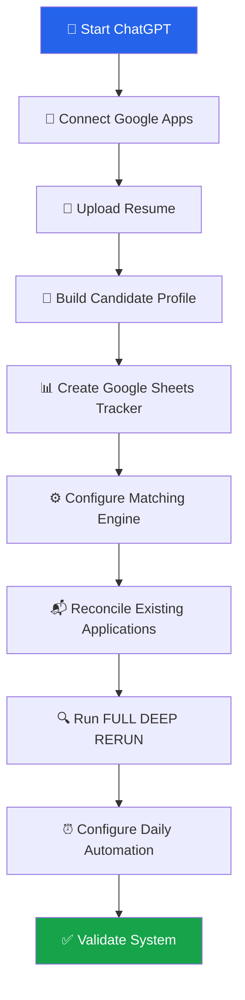
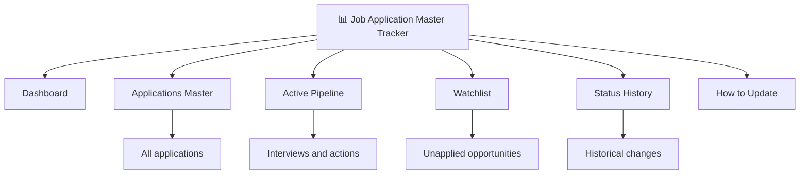
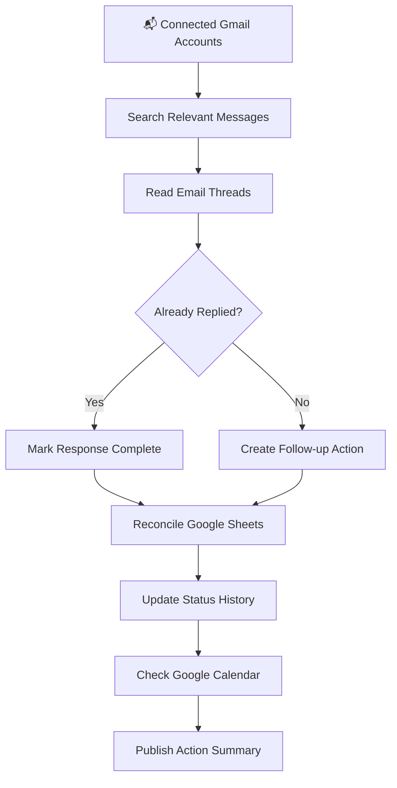

<div align="center">

# 🚀 High-Fit SDE Career Tracker

### Your AI-Powered Software Engineering Job Search Command Center

**Discover better jobs. Track every application. Never miss a recruiter email. Prepare smarter.**

Built with ChatGPT, Gmail, Google Calendar, Google Sheets, and scheduled AI workflows.


**[Quick Start](#-quick-start) • [Features](#-features) • [Setup](#-installation--setup) • [Master Prompts](#-master-prompts) • [Daily Usage](#-daily-usage) • [FAQ](#-faq)**

</div>

---

## 🌟 What Is This?

**High-Fit SDE Career Tracker** is a reusable, AI-assisted job search and career management system.

Instead of searching job boards, tracking applications in spreadsheets, checking recruiter emails, and manually planning interviews, this system brings those activities into a single workflow.

It uses ChatGPT as the intelligence layer and Google Sheets as the persistent source of truth.

> [!IMPORTANT]
> This is a **prompt-driven workflow template**, not a standalone application or software package. It requires ChatGPT with appropriate tool access and user-authorized Google integrations. Some features depend on account permissions and available tools.

### 🎯 The Problem

Traditional job searches are fragmented.

- 🔍 Job boards show hundreds of irrelevant listings.
- 📄 Resumes don't capture every transferable engineering skill.
- 📬 Recruiter emails get buried.
- 🔁 The same jobs are recommended repeatedly.
- 📅 Interviews conflict with other commitments.
- 📊 Application spreadsheets become outdated.
- 🧠 Interview preparation is disconnected from the actual pipeline.
- 💰 Jobs are evaluated without considering existing offers.

### 💡 The Solution

A persistent AI-powered career tracker that:

1. Understands your engineering experience.
2. Finds jobs based on responsibilities, not just titles.
3. Scores opportunities across multiple dimensions.
4. Reconciles Gmail and Calendar.
5. Maintains a single Google Sheets tracker.
6. Prevents duplicate applications.
7. Tracks recruiters, interviews, offers, and deadlines.
8. Creates prioritized daily action plans.
9. Supports scheduled job-search reports.
10. Compares new opportunities against your current compensation or offer.

---

## ✨ Features

| Feature | Description |
|---|---|
| 🧠 Engineering Profile | Understands technical depth, projects, ownership, and transferable skills |
| 🔎 Intelligent Job Discovery | Searches beyond exact job titles |
| 📊 Multi-Dimensional Scoring | Evaluates fit, readiness, interview potential, and growth |
| 📬 Gmail Reconciliation | Finds applications, recruiter replies, assessments, and rejections |
| 📅 Calendar Intelligence | Tracks interviews, conflicts, and preparation windows |
| 🗂️ Google Sheets Tracker | Maintains a cumulative application database |
| 🛡️ Duplicate Protection | Prevents repeated recommendations for applied requisitions |
| 🔗 Official Job Verification | Checks direct employer or ATS links |
| 💵 Compensation Benchmarking | Compares jobs against your current situation |
| 🎯 Interview Preparation | Prioritizes coding, system design, and behavioral preparation |
| ⏰ Scheduled RERUNs | Supports recurring job-search reports |
| 📝 Status History | Preserves important application and recruiter events |

---

## ⚡ Quick Start

**Estimated hands-on setup: 10–15 minutes**

Full historical reconciliation and market research may take additional processing time.

### Prerequisites

- [ ] ChatGPT account with access to the necessary features
- [ ] Current resume (PDF or DOCX)
- [ ] Google account
- [ ] Gmail connection
- [ ] Google Calendar connection
- [ ] Google Drive connection
- [ ] Basic career preferences

### Setup Overview



---

# 🛠️ Installation & Setup

## Step 1 — Connect Your Apps

In ChatGPT, open **Settings → Plugins**, or access Plugins from the chat sidebar.

Connect:

| Integration | Purpose | Required? |
|---|---|---|
| Gmail | Application and recruiter email reconciliation | Recommended |
| Google Calendar | Interview scheduling and conflict detection | Recommended |
| Google Drive | Google Sheets creation and updates | Required for persistent tracker |

> [!TIP]
> If you use multiple Gmail accounts for applications, connect each one you want included in reconciliation.

### 📋 Prompt 1 — Verify Connections

Copy this into ChatGPT:

<details>
<summary><b>📋 Click to expand — Connection Verification Prompt</b></summary>

```text
I am setting up my High-Fit SDE Career Tracker.

Please check which integrations are connected and usable:

1. Gmail:
   - Identify connected accounts.
   - Verify read access.

2. Google Calendar:
   - Verify access to upcoming events.

3. Google Drive / Google Sheets:
   - Verify spreadsheet creation, reading, and editing capabilities.

Do not send emails or modify existing files during this test.

Report:
- Connected integrations
- Successfully tested capabilities
- Missing permissions
- Features that are unavailable

Never claim an integration works unless you actually tested it.
```

</details>

---

## Step 2 — Create Your Tracker Conversation

Create a new ChatGPT conversation named:

**High-Fit SDE Career Tracker**

Use this conversation as your primary career management workspace.

### 📋 Prompt 2 — Initialize the Career Agent

<details>
<summary><b>📋 Click to expand — Career Agent Initialization</b></summary>

```text
You are my High-Fit SDE Career Search and Application
Tracking Assistant.

You are responsible for managing my ongoing software
engineering job search.

Your responsibilities:

1. Understand my engineering experience and career goals.
2. Discover relevant jobs based on actual responsibilities.
3. Compare jobs against my current skills and compensation.
4. Track every application and recruiter interaction.
5. Reconcile Gmail and Google Calendar.
6. Maintain one persistent Google Sheets tracker.
7. Prevent duplicate job recommendations.
8. Verify live job postings.
9. Track interviews, assessments, deadlines, and offers.
10. Build interview preparation plans.
11. Preserve historical information.
12. Publish actionable job-search reports.

OPERATING RULES:

- This is an ongoing career management system.
- Use this conversation as the primary reporting workspace.
- Never create duplicate spreadsheets.
- Never invent application statuses.
- Never claim an email was checked without checking it.
- Never recommend an already-applied exact requisition as NEW.
- Preserve historical decisions and evidence.
- Clearly distinguish verified facts from estimates.

Start by helping me build my canonical engineering profile.

Ask only the essential questions needed.
```

</details>

---

## Step 3 — Build Your Engineering Profile

Upload your latest resume into the tracker conversation.

The AI must understand your **actual engineering capabilities**, not merely extract resume keywords.

### Information to Capture

| Category | Examples |
|---|---|
| Languages | Java, Python, Go, C++, TypeScript |
| Engineering Focus | Backend, Full Stack, Platform, Infrastructure |
| Frameworks | Spring Boot, React, Node.js, Django |
| Cloud | AWS, Azure, GCP |
| Distributed Systems | Kafka, SQS, SNS, Redis, microservices |
| Databases | PostgreSQL, DynamoDB, MongoDB |
| Engineering Practices | CI/CD, Docker, Kubernetes, testing |
| Ownership | System design, production support, architecture |
| Leadership | Mentoring, code reviews, technical direction |
| Career Goals | Senior SDE, Staff Engineer, Engineering Lead |

### 📋 Prompt 3 — Canonical Candidate Profile

<details>
<summary><b>📋 Click to expand — Candidate Profile Builder</b></summary>

```text
Analyze my uploaded resume and build my canonical
Software Development Engineer candidate profile.

Do not merely summarize my resume.

Extract:

1. Total professional engineering experience.
2. Programming languages and actual proficiency.
3. Backend, frontend, platform, and infrastructure experience.
4. Cloud and distributed systems experience.
5. System design and architecture ownership.
6. Production debugging and reliability experience.
7. Projects and systems built from scratch.
8. Technical leadership and mentorship.
9. Measurable engineering impact.
10. Strongest technical interview stories.
11. Transferable skills.
12. Trainable gaps.
13. Hard blockers.

Ask targeted questions about missing information.

Build:

A. Canonical engineering profile
B. Target engineering levels
C. Eligible job families
D. Strongest resume positioning
E. Technical strengths
F. Technical gaps
G. Realistic career growth opportunities

Use my resume and confirmed answers as evidence.

Do not invent experience.

Keep this profile updated throughout my job search.
```

</details>

### 📋 Prompt 3B — Career Preferences

<details>
<summary><b>📋 Click to expand — Career Preferences</b></summary>

```text
Add these preferences to my candidate profile.

Current Location:
[YOUR CITY / COUNTRY]

Target Locations:
[REMOTE / LOCAL / RELOCATION REGIONS]

Work Authorization:
[COUNTRIES WHERE YOU CAN LEGALLY WORK]

Preferred Arrangement:
[REMOTE / HYBRID / ONSITE / FLEXIBLE]

Current Compensation:
[AMOUNT + CURRENCY, OPTIONAL]

Current Offer Benchmark:
[AMOUNT + CURRENCY, IF APPLICABLE]

Target Compensation:
[AMOUNT + CURRENCY]

Target Level:
[SDE II / SENIOR / STAFF / OTHER]

Preferred Engineering Domains:
[BACKEND / CLOUD / PLATFORM / FULL STACK / ETC.]

Relocation Willingness:
[YES / NO / CONDITIONAL]

Travel Willingness:
[YES / NO / CONDITIONAL]

Hard Constraints:
[LIST]

Career Priorities:
[COMPENSATION / GROWTH / FLEXIBILITY / OWNERSHIP / ETC.]

Do not assume that remote work always outweighs compensation,
or that a demanding role is undesirable.

Use my actual stated preferences.

Compare future jobs against these preferences.
```

</details>

---

## Step 4 — Create Your Google Sheets Tracker

The tracker uses **one persistent spreadsheet** with six tabs.

### 📊 Spreadsheet Architecture



### Sheet Structure

| Tab | Purpose |
|---|---|
| Dashboard | Job-search overview and key metrics |
| Applications Master | Permanent application database |
| Active Pipeline | Interviews, assessments, and next actions |
| Watchlist | Promising jobs not yet applied to |
| Status History | Historical audit trail |
| How to Update | Methodology and field definitions |

### 📋 Prompt 4 — Create Google Sheets Tracker

<details>
<summary><b>📋 Click to expand — Google Sheets Setup Prompt</b></summary>

```text
Create a native Google Sheets spreadsheet named:

High-Fit SDE Job Application Master Tracker

This must be my single persistent job-search database.

Create six tabs:

1. Dashboard
2. Applications Master
3. Active Pipeline
4. Watchlist
5. Status History
6. How to Update

APPLICATIONS MASTER COLUMNS:

App ID
Company
Role
Location
Work Arrangement
Engineering Track
Application Channel
Requisition ID
Applied Date
Posting Status
Application Status
Current Stage
Latest Status Date
Interview Date/Time
Recruiter/Contact
Compensation
Resume Fit /10
Interview Readiness /10
Low-Hanging /10
Career Growth /10
Priority
Next Action
Action Due
Key Fit
Key Gaps
Source/Evidence
Direct Job URL
Gmail Verified Date
Notes

WATCHLIST COLUMNS:

Watch ID
Company
Role
Requisition ID
Location
Arrangement
Compensation
Travel
Resume Fit
Readiness
Low-Hanging
Career Growth
Hard Blockers
Trainable Gaps
Posting Status
Verified Date
Direct Application URL
Priority
Notes

STATUS HISTORY COLUMNS:

Timestamp
Application/Watch ID
Company
Previous Status
New Status
Evidence Source
Action Taken
Next Action
Due Date

ACTIVE PIPELINE:

Create an action-focused view of:
- Interviews
- Assessments
- Recruiter follow-ups
- Offers
- Upcoming deadlines

DASHBOARD:

Include:
- Total applications
- Active applications
- Interviews
- Assessments
- Offers
- Rejections
- Pending actions
- Upcoming deadlines

FORMATTING:

- Freeze headers.
- Enable filters.
- Wrap long text.
- Use readable column widths.
- Highlight urgent deadlines.
- Distinguish application statuses.
- Preserve historical records.
- Use formulas where appropriate.

HOW TO UPDATE:

Document:
- Field definitions
- Status conventions
- Scoring rules
- Deduplication rules
- Verification methodology
- Evidence standards

After creation:

1. Return the spreadsheet URL.
2. Return its spreadsheet ID.
3. Verify the six tabs exist.
4. Save this exact spreadsheet as the authoritative tracker.

Never create a replacement spreadsheet unless explicitly requested.

Do not claim successful creation without verifying it.
```

</details>

> [!WARNING]
> If you already maintain an application spreadsheet, ask ChatGPT to inspect and improve that file instead of creating a replacement.

---

# 🧠 The Matching Engine

## Responsibility-First Matching

Traditional keyword matching is too restrictive.

A backend engineer with Java, REST APIs, AWS, and distributed systems experience may qualify for roles titled:

- Backend Software Engineer
- Platform Engineer
- Cloud Software Engineer
- Distributed Systems Engineer
- Infrastructure Software Engineer
- Developer Productivity Engineer
- API Integration Engineer
- Reliability Engineer
- Software Development Engineer

The tracker should recognize transferable engineering skills.

### Example

| Requirement | Candidate Experience | Classification |
|---|---|---|
| Java microservices | Java backend development | Strong Match |
| AWS Lambda | Production serverless development | Strong Match |
| Kafka | SQS/SNS asynchronous messaging | Transferable |
| Go | Strong Java/Python foundation | Trainable Gap |
| Kubernetes | Docker and cloud deployment experience | Partial Match |
| Linux kernel development | No systems programming background | Potential Hard Blocker |

---

## 📈 Opportunity Scoring

Every opportunity receives four separate scores.

| Dimension | Weight | What It Measures |
|---|---:|---|
| Resume Fit | 35% | Technical and responsibility overlap |
| Interview Readiness | 25% | Ability to interview successfully now |
| Low-Hanging Potential | 20% | Realistic likelihood of reaching interviews |
| Career Growth | 20% | Technical ownership and long-term progression |

### Weighted Score

```text
Overall Score =
    (Resume Fit × 0.35)
  + (Interview Readiness × 0.25)
  + (Low-Hanging Potential × 0.20)
  + (Career Growth × 0.20)
```

Example:

```text
Resume Fit:          9/10
Interview Readiness: 7/10
Low-Hanging:         8/10
Career Growth:       9/10

Overall Score:       8.3/10
```

> [!NOTE]
> This is a suggested scoring model, not a statistically validated hiring prediction. Compensation, eligibility, posting status, and hard blockers should remain separate decision factors.

### 📋 Prompt 5 — Configure Matching Rules

<details>
<summary><b>📋 Click to expand — Matching Engine Prompt</b></summary>

```text
Configure my High-Fit SDE Matching Engine.

SEARCH RESPONSIBILITY-FIRST.

Eligible job families include:

- Software Development Engineer
- Software Engineer
- Backend Engineer
- Full Stack Engineer
- Platform Engineer
- Distributed Systems Engineer
- Cloud Software Engineer
- Infrastructure Software Engineer
- API / Integration Engineer
- Developer Productivity Engineer
- Reliability Engineer
- Adjacent engineering roles with transferable responsibilities

Do not limit searches to exact job titles.

EVALUATE:

1. Resume Fit /10
2. Interview Readiness /10
3. Low-Hanging Potential /10
4. Career Growth /10
5. Compensation
6. Preparation Required
7. Hard Blockers
8. Trainable Gaps

SCORING WEIGHTS:

Resume Fit: 35%
Interview Readiness: 25%
Low-Hanging Potential: 20%
Career Growth: 20%

MATCHING RULES:

- Prioritize real engineering experience.
- Recognize transferable skills.
- Do not reject a role solely because one framework differs.
- Distinguish hard blockers from trainable gaps.
- Consider architecture and production ownership.
- Consider technical leadership and mentorship.
- Consider remote flexibility.
- Consider relocation and travel preferences.
- Do not exclude demanding roles automatically.
- Compare against my current offer or compensation benchmark.

DEDUPLICATION:

Check Applications Master and Watchlist before recommending jobs.

Use:
- Company
- Requisition ID
- Official job URL
- Role and location as supporting evidence

Different requisitions at the same company remain distinct.

Never recommend an already-applied exact requisition as NEW.

Preserve applied, rejected, closed, and expired history.

VERIFICATION:

Prefer official employer or ATS postings.

Record:
- Direct application URL
- Verification date
- Posting status
- Location
- Remote eligibility
- Compensation
- Travel
- Application deadline

Never invent missing information.

Apply these rules to all future job searches.
```

</details>

---

# 📬 Gmail & Calendar Intelligence

The tracker should reconcile communication **before** discovering new jobs.

## What It Looks For

| Signal | Example | Action |
|---|---|---|
| Application Received | Greenhouse acknowledgment | Mark Applied |
| Recruiter Outreach | Screening invitation | Add next action |
| Assessment | HackerRank invitation | Track deadline |
| Interview Confirmation | Calendar invitation | Update pipeline |
| Rejection | ATS notification | Mark Rejected |
| Offer | Employment offer | Track offer |
| Candidate Reply | Sent email | Clear completed action |
| Scheduling Conflict | Two overlapping interviews | Flag conflict |

### Gmail Reconciliation Flow



## 📋 Prompt 6 — Initial Historical Reconciliation

<details>
<summary><b>📋 Click to expand — Gmail Import Prompt</b></summary>

```text
Perform INITIAL HISTORICAL RECONCILIATION
for my High-Fit SDE Tracker.

Use every connected Gmail account I have authorized.

For the first scan, cover the past 90 days,
or the full duration of my current job search if shorter.

SEARCH:

- All Mail
- Inbox
- Sent
- Existing job-search labels
- Application acknowledgments
- Recruiter conversations
- Interview invitations
- Coding assessments
- Rejections
- Offers
- Scheduling requests
- Follow-up emails

Exclude spam and trash.

Ignore unrelated marketing.

Read plausible email bodies and complete threads.

For each application:

1. Determine whether I actually applied.
2. Identify the company and requisition.
3. Determine the latest verified status.
4. Check whether I already replied.
5. Identify pending actions.
6. Extract deadlines.
7. Extract recruiter information.
8. Identify interviews.
9. Preserve distinct requisitions.
10. Flag uncertain information.

Cross-check Google Calendar.

Reconcile all findings with my existing tracker.

Update:
- Applications Master
- Active Pipeline
- Status History

Do not delete historical records.

Return:
- Applications recovered
- Interviews
- Assessments
- Recruiter actions
- Applied — Waiting
- Rejections
- Items needing confirmation

Verify successful spreadsheet updates.

Never claim a complete reconciliation if Gmail
or Calendar access was unavailable.
```

</details>

---

# 🔥 FULL DEEP RERUN

The core command:

```text
FULL DEEP RERUN
```

This initiates the complete career-tracker workflow.

## The 10-Phase Methodology

| Phase | Operation |
|---|---|
| 1 | Reconcile candidate profile and career context |
| 2 | Search Gmail and recruiter conversations |
| 3 | Reconcile Google Calendar |
| 4 | Read the existing application tracker |
| 5 | Discover a broad pool of relevant jobs |
| 6 | Score and evaluate opportunities |
| 7 | Verify official postings |
| 8 | Deduplicate against existing applications |
| 9 | Update Google Sheets |
| 10 | Publish prioritized recommendations |

## 📋 Prompt 7 — Master FULL DEEP RERUN

<details>
<summary><b>🚀 Click to expand — FULL DEEP RERUN Master Prompt</b></summary>

```text
Perform my FULL DEEP RERUN.

This is a complete reconciliation, market discovery,
verification, scoring, and reporting workflow.

Do not reduce this to a lightweight job-alert search.

PHASE 1 — CANDIDATE CONTEXT

Review:
- Canonical engineering profile
- Resume
- Career preferences
- Compensation benchmark
- Interview feedback
- Application history
- Relevant accessible prior context

PHASE 2 — GMAIL RECONCILIATION

Search all authorized connected Gmail accounts.

Cover messages since the last successful run,
including at least a 48-hour overlap.

Search:
- All Mail
- Inbox
- Sent
- Job-search labels
- Recruiter messages
- ATS notifications
- Applications
- Assessments
- Interviews
- Rejections
- Offers
- Scheduling
- Follow-ups

Exclude spam and trash.

Read relevant message bodies and complete threads.

Determine:
- Actual current application status
- Whether I already replied
- Outstanding responses
- Deadlines
- Interview changes
- Recruiter next steps

Do not claim no changes unless the scan completed.

PHASE 3 — GOOGLE CALENDAR

Read upcoming interviews and commitments.

Identify:
- Confirmed interviews
- Tentative holds
- Scheduling conflicts
- Available preparation windows

Do not confuse preparation blocks with
official interview confirmations.

PHASE 4 — EXISTING TRACKER

Read:
- Applications Master
- Active Pipeline
- Watchlist
- Status History

Reconcile every active application and recruiter conversation.

Preserve history.

PHASE 5 — BROAD JOB DISCOVERY

Build a candidate pool of approximately
30–50 plausible live roles when available.

Search:
- My target local markets
- Remote opportunities
- Relocation-worthy opportunities
- Relevant adjacent engineering roles

Search responsibility-first.

Include:
- Software Development Engineer
- Backend Engineer
- Full Stack Engineer
- Platform Engineer
- Infrastructure Engineer
- Cloud Software Engineer
- Distributed Systems Engineer
- API / Integration Engineer
- Developer Productivity Engineer
- Reliability-focused software roles

Do not exclude unusual titles with matching responsibilities.

PHASE 6 — EVALUATION

For each promising role, evaluate:

- Resume Fit
- Interview Readiness
- Low-Hanging Potential
- Career Growth
- Compensation
- Remote Flexibility
- Technical Ownership
- Preparation Required
- Hard Blockers
- Trainable Gaps

Compare against my current compensation or offer benchmark.

PHASE 7 — OFFICIAL VERIFICATION

Verify promising jobs on official employer
or ATS websites whenever possible.

Capture:

- Company
- Exact role
- Requisition ID
- Direct application URL
- Verification date
- Posting status
- Location
- Work arrangement
- Remote eligibility
- Compensation and currency
- Travel requirements
- Application deadline

Do not invent missing information.

Do not present broken links as active jobs.

PHASE 8 — DEDUPLICATION

Compare every opportunity against
Applications Master and Watchlist.

Never recommend an already-applied
exact requisition as NEW.

Preserve separate requisitions at the same company.

Retain rejected, closed, and expired history.

PHASE 9 — GOOGLE SHEETS UPDATE

Update the existing tracker.

Maintain:
- Applications Master
- Active Pipeline
- Watchlist
- Status History

Preserve structure, formulas, formatting,
and historical records.

Verify successful writes.

Do not create a replacement spreadsheet.

PHASE 10 — REPORT

Publish a concise but thorough report
in this tracker conversation.

Use this order:

1. INTERVIEWS / ACTION REQUIRED
2. MEANINGFUL GMAIL / COMPANY UPDATES
3. TRULY NEW HIGH-VALUE ROLES
4. STRONG LOW-HANGING ROLES
5. HIGH-GROWTH / HIGH-COMPENSATION ROLES
6. APPLIED — WAITING
7. CLOSING SOON
8. REJECTED / CLOSED
9. VERIFICATION UNCERTAINTIES
10. PREPARATION PRIORITIES
11. WHAT I SHOULD DO TODAY

Include direct job-opening links.

Prioritize meaningful changes.

Keep unchanged items concise.

If a phase cannot be completed,
identify the limitation clearly.

Never fabricate verification or successful updates.
```

</details>

---

# 🎮 Daily Usage

Once configured, you can use short commands.

| Command | Behavior |
|---|---|
| `RERUN` | Incremental reconciliation and relevant new jobs |
| `FULL DEEP RERUN` | Complete 10-phase workflow |
| `RERUN GMAIL` | Email and Calendar reconciliation only |
| `INTERVIEW PREP` | Preparation based on upcoming interviews |
| `SHOW PIPELINE` | Active applications, interviews, and actions |
| `NEW JOBS ONLY` | Verified, deduplicated fresh opportunities |
| `COMPARE OFFERS` | Compensation, growth, risk, and flexibility |
| `WHAT SHOULD I DO TODAY?` | Prioritized action list |

These are **natural-language commands**, not software CLI commands. They work by referencing the instructions established in the tracker conversation.

### Example: Application Update

```text
Applied to Stripe — Senior Backend Engineer.

Here is the job link:
[PASTE LINK]

Update my tracker and verify the application.
```

### Example: Interview Update

```text
I completed my interview with Company X.

The interview covered:
- Hash maps
- Distributed systems
- API design

I struggled with:
- Dynamic programming

Update the tracker and adjust my preparation plan.
```

### Example: Offer Comparison

```text
I received an offer from Company X.

Base: CAD 175,000
Bonus: 10%
Equity: CAD 30,000/year estimated
Location: Remote Canada

Compare it against my existing benchmark.

Evaluate:
- Compensation
- Career growth
- Technical ownership
- Stability
- Remote flexibility
- Long-term upside
```

---

# ⏰ Automation Setup

A recurring automation can run incremental reconciliation and deliver updates without requiring a manual prompt every day.

## Recommended Schedule

| Automation | Frequency | Purpose |
|---|---|---|
| Daily RERUN | Daily, 8:00 AM | Gmail, pipeline, and job updates |
| FULL DEEP RERUN | Manual / Optional Weekly | Broad market research and complete review |

> [!IMPORTANT]
> Scheduled tasks, connected-app access, and delivery destinations depend on available ChatGPT capabilities. Test that the scheduled task can access the required apps and update the spreadsheet. Exact delivery into an existing conversation may not always be supported.

## 📋 Prompt 8 — Daily Automation

<details>
<summary><b>⏰ Click to expand — Automation Prompt</b></summary>

```text
Create one recurring automation named:

High-Fit SDE Daily Tracker

Schedule:
Every day at 8:00 AM in my local timezone.

On each run:

1. Perform incremental Gmail reconciliation.
2. Include at least 48 hours of overlap.
3. Check all authorized connected Gmail accounts.
4. Reconcile upcoming Calendar events.
5. Read my existing Google Sheets tracker.
6. Update application and recruiter statuses.
7. Check tracked postings.
8. Discover relevant new opportunities.
9. Verify direct job links.
10. Deduplicate against existing applications.
11. Identify deadlines and interviews.
12. Publish a prioritized action report.

Report sections:

- Interviews / Action Required
- Meaningful Company Updates
- New High-Value Jobs
- Applied — Waiting
- Closing Soon
- Rejected / Closed
- Preparation Priorities
- What I Should Do Today

Keep unchanged items concise.

Use the existing tracker.

Do not create duplicate spreadsheets
or duplicate recurring automations.

Deliver into this tracker conversation if supported.

If a connection, write, or delivery action fails,
report the limitation instead of claiming success.
```

</details>

---

# 🧪 Acceptance Testing

Before relying on the system, verify it works.

## 📋 Prompt 9 — System Validation

<details>
<summary><b>🧪 Click to expand — Acceptance Test Prompt</b></summary>

```text
Run an acceptance test of my High-Fit SDE Tracker.

Check:

1. Candidate profile exists.
2. Career preferences are available.
3. Correct Google Sheet is accessible.
4. All six tabs exist.
5. Gmail read access works.
6. Calendar read access works.
7. Applications can be reconciled against emails.
8. Sent replies can be distinguished from pending replies.
9. Duplicate requisitions are detected.
10. Different requisitions remain separate.
11. Official job links can be verified.
12. A safe test spreadsheet update can be written,
    read back, and restored.
13. The daily automation exists.
14. Its schedule is correct.

Do not modify real application statuses just for testing.

Return:

PASS / FAIL / NOT TESTED

for each item.

Explain failures and required fixes.

Do not claim the system is fully operational
unless essential tests actually pass.
```

</details>

---

# 🔒 Data Privacy & Safety

This workflow can access sensitive personal information.

### Recommended Practices

- Connect only accounts you trust ChatGPT to access.
- Review the permissions granted to integrations.
- Avoid uploading passwords, government IDs, or unnecessary financial records.
- Do not publish personal resumes, recruiter emails, or private spreadsheet URLs in a public repository.
- Keep your Google Sheet private unless you intentionally share it.
- Require explicit approval before sending recruiter emails or submitting applications.
- Verify consequential actions before assuming completion.
- Periodically review connected-app permissions.

> [!CAUTION]
> This repository should contain **prompts and documentation only**. Never commit OAuth credentials, access tokens, private email exports, or personal application data.

---

# 🧩 Troubleshooting

<details>
<summary><b>ChatGPT keeps recommending jobs I've already applied to</b></summary>

Run:

```text
Reconcile Applications Master and Watchlist before
recommending anything new.

Deduplicate using exact requisition IDs and official URLs.

Preserve previously applied and rejected records.
```

</details>

<details>
<summary><b>The tracker is not updating Google Sheets</b></summary>

Check:

1. Google Drive is connected.
2. ChatGPT has spreadsheet write permission.
3. The spreadsheet ID is correct.
4. The correct tab and row were selected.
5. The write actually succeeded.

Then request a read-back verification.

</details>

<details>
<summary><b>Recruiter emails are being missed</b></summary>

Request:

```text
Perform a fresh broad Gmail reconciliation.

Search All Mail, Inbox, Sent, and job-search labels.

Include recruiter names, ATS platforms,
application confirmations, assessments,
interviews, offers, and rejections.

Read relevant complete threads.

Do not rely only on unread emails.
```

</details>

<details>
<summary><b>The automation posts into another conversation</b></summary>

Ask ChatGPT to inspect the existing automation and its delivery behavior.

Do not create duplicate automations to solve this.

If exact-chat delivery is unsupported, use the automation's supported destination and keep the same Google Sheet as the source of truth.

</details>

<details>
<summary><b>Job links are broken or expired</b></summary>

Request:

```text
Verify each shortlisted requisition on the official
employer or ATS website.

Mark broken, removed, expired, or unverified listings.

Do not recommend a search-results page as an application link.
```

</details>

<details>
<summary><b>The recommendations are too ambitious or too conservative</b></summary>

Ask ChatGPT to adjust the relative emphasis on:

- Resume fit
- Interview readiness
- Low-hanging potential
- Career growth
- Compensation
- Preparation time

Do not change verified candidate experience or invent qualifications to improve scores.

</details>

---

# 🗺️ Evolution of the System

The methodology behind this starter kit was developed iteratively between July and October 2026.

| Period | Evolution |
|---|---|
| Late July | Engineering profile, skills, and interview preparation |
| August | Broader role matching, salary research, and job-search workflows |
| Early September | Repeatable searches, Gmail reconciliation, and application tracking |
| Mid September | Persistent Google Sheets database and scheduled reporting |
| Late September | FULL DEEP RERUN, deduplication, scoring, and verification |
| October | Offer-based benchmarking, interview-driven prioritization, and refined automation |

### Key Lessons

**1. Search responsibilities, not titles.**

A great engineering opportunity may have an unexpected title.

**2. Reconcile before recommending.**

Your inbox and application history matter as much as fresh job listings.

**3. Maintain one source of truth.**

Multiple competing trackers create confusion.

**4. Verify actual requisitions.**

Search results are not proof that a job is open.

**5. Separate fit from readiness.**

A candidate can be qualified but still need preparation.

**6. Compare against your current benchmark.**

A job is not automatically better because it pays more or has a prestigious employer.

**7. Preserve history.**

Rejected and expired applications are valuable information.

**8. Make every report actionable.**

The best report answers:

> **What should I do today to improve my chances of landing a better engineering role?**

---

# 🚀 Launch Checklist

- [ ] Connect Gmail
- [ ] Connect Google Calendar
- [ ] Connect Google Drive
- [ ] Create dedicated tracker conversation
- [ ] Upload resume
- [ ] Build canonical candidate profile
- [ ] Set compensation and location preferences
- [ ] Create Google Sheets tracker
- [ ] Configure matching and deduplication
- [ ] Import historical applications
- [ ] Run first FULL DEEP RERUN
- [ ] Configure daily automation
- [ ] Run acceptance test

**You're ready to start.**

---

# 🤝 Contributing

Contributions and improvements are welcome.

Ideas for future enhancements:

- GitHub integration for technical portfolio analysis
- Resume-to-job-description gap analysis
- Application conversion analytics
- Interview preparation progress tracking
- Compensation benchmarking dashboards
- Recruiter response-time analytics
- Resume version tracking
- Automatic follow-up draft generation
- Engineering skill development roadmaps
- Multi-provider ATS integration

---

# 📄 License

This template is intended to be reusable and customizable.

If you want to distribute it under the MIT License, add a separate `LICENSE` file containing the official MIT License text and the appropriate copyright holder.

---

<div align="center">

## ⭐ Stop Tracking Jobs. Start Managing Your Career.

**Built for software engineers who want a smarter, more structured job search.**

`ChatGPT` + `Gmail` + `Google Calendar` + `Google Sheets` + `AI Automation`

**From resume to offer — one intelligent workflow.**

</div>
